---
author:
  name: Жаворонков Кирилл Александрович
title: "Лабораторная работа"
subtitle: "Номер 3"
license: CC BY
date: today
date-format: "YYYY-MM-DD"
lang: ru-RU
format:
  pptx:
    toc: false
  pdf:
    toc: false
---

# Докладчик

* Жаворонков Кирилл Александрович
* Студент
* Группа: НПИбд-01-23
* Номер студенческого билета: 1132231844

# Цель работы

* Освоить циклы while и for, функции и сторонние пакеты Julia.
* Решать задачи линейной алгебры и работать с матрицами.
* Выполнить примеры раздела 3.2 и задания 3.4.1–3.4.11.

# Слайд 1. Циклы for и двумерный массив

* Цикл for с шагом: 1, 3, 5, 7, 9.
* Перебор массива строк с приветствием.
* Двумерный массив: значение ячейки равно сумме индексов.

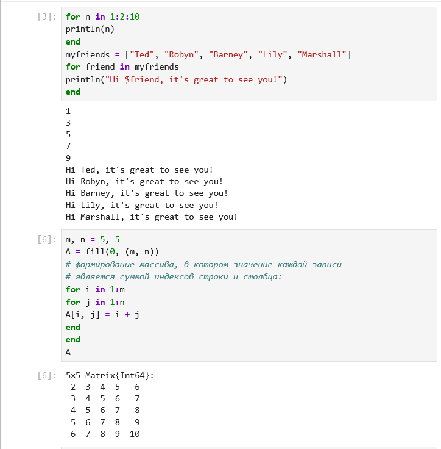{height=55%}

# Слайд 2. Три способа построить массив

* fill + цикл for, цикл for i in 1:m, j in 1:n и генератор.
* Все три варианта дают один и тот же массив.
* Проверка FizzBuzz для N = 15: результат FizzBuzz.

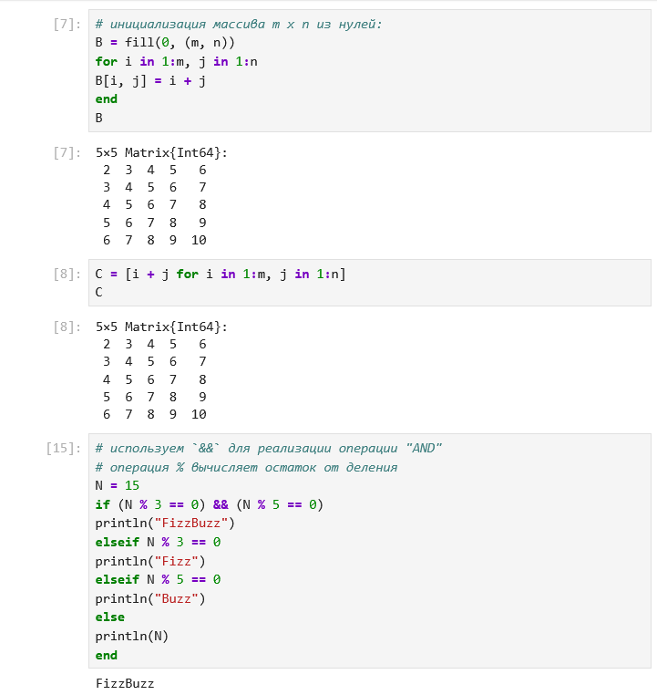{height=55%}

# Слайд 3. Условия, тернарный оператор, функции

* Тернарный оператор: (5 > 10) ? 5 : 10 даёт 10.
* Функция sayhi("C-3PO") и f(42) = 1764.
* Три способа объявления функции.

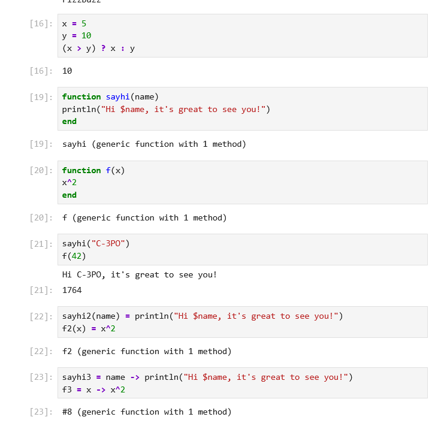{height=55%}

# Слайд 4. sort и sort!

* sort(v) возвращает новый массив, v не меняется.
* sort!(v) сортирует массив на месте.

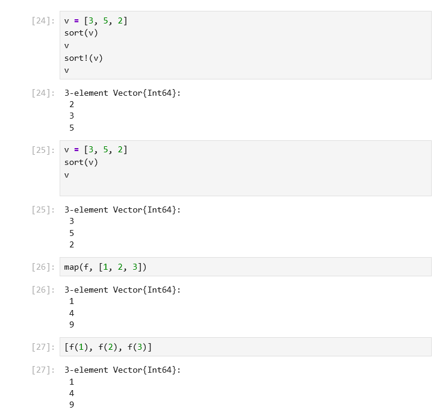{height=55%}

# Слайд 5. map и broadcast

* map(f, [1, 2, 3]) даёт 1, 4, 9.
* map(x -> x^3, ...) даёт 1, 8, 27.
* broadcast и f.(...) дают тот же результат.
* Матрица A = [1 2 3; 4 5 6; 7 8 9].

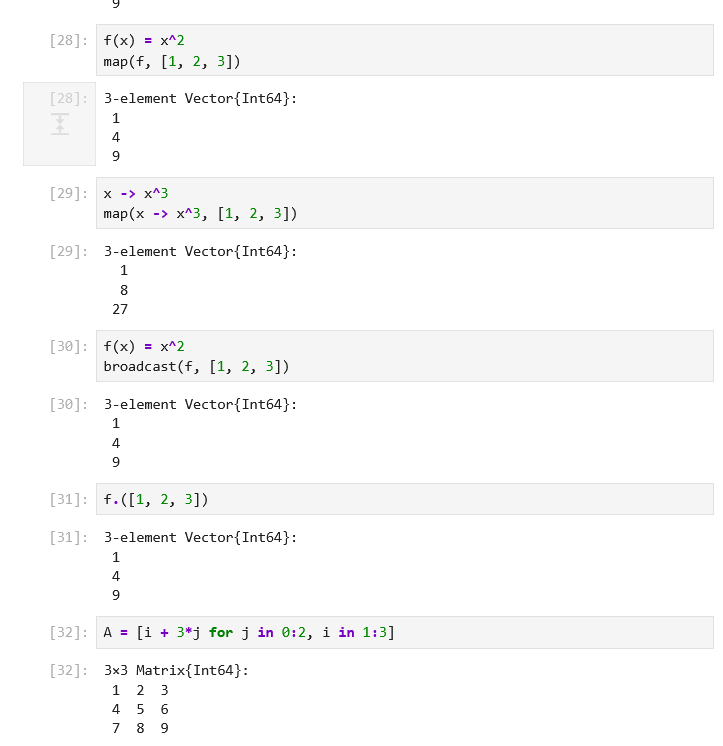{height=55%}

# Слайд 6. Пакет Colors

* Палитра distinguishable_colors(100).
* rand(palette, 3, 3) — случайная матрица 3×3 цветов.

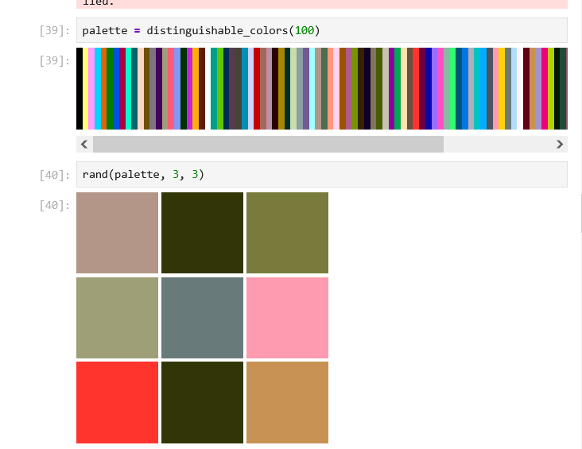{height=55%}

# Слайд 7. Задания 3.4.2–3.4.4

* 3.4.2: if и тернарный оператор; для 14 — число, для 15 — «нечётное».
* 3.4.3: add_one(5) = 6.
* 3.4.4: матрица [1 4 7; 2 5 8; 3 6 9] через map.

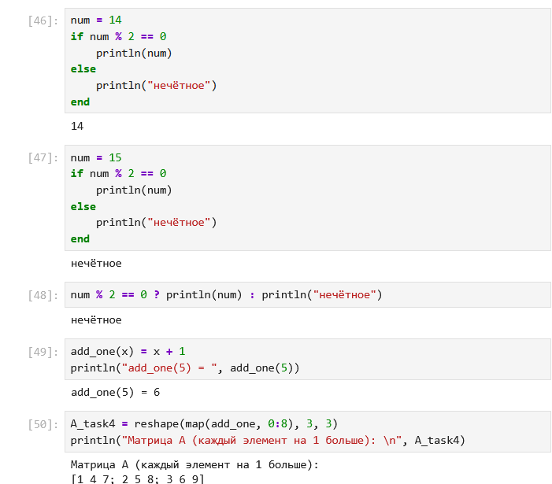{height=55%}

# Слайд 8. Задания 3.4.5–3.4.7

* 3.4.5: A³ — нулевая матрица; третий столбец заменён суммой второго и третьего.
* 3.4.6: C = BᵀB = [1500 −1500 1500; −1500 1500 −1500; 1500 −1500 1500].
* 3.4.7: матрица Z1 совпадает с эталоном.

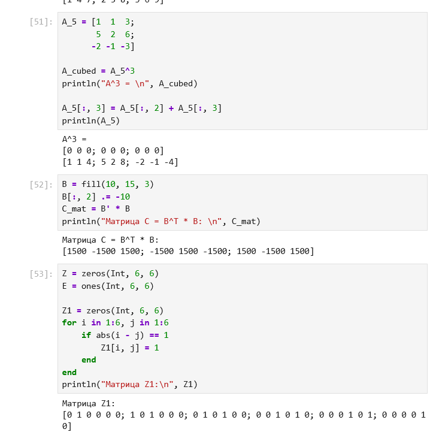{height=55%}

# Слайд 9. Функция outer (3.4.8)

* outer(x, y, operation) строит матрицы поэлементно.
* A1, A3, A4 совпадают с эталоном.
* A2 и A5 требуют исправления; обобщение на матричное умножение не выполнено.

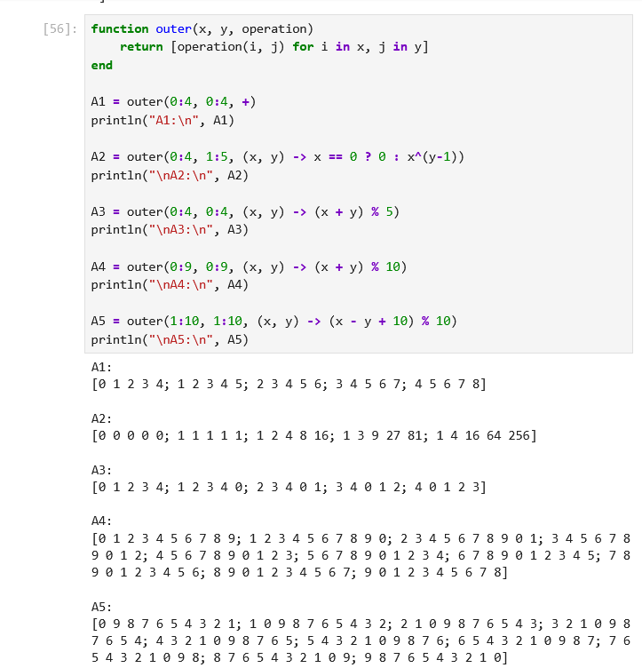{height=55%}

# Слайд 10. СЛАУ и случайная матрица (3.4.9–3.4.10)

* 3.4.9: x ≈ [−2, 3, 5, 2, −4].
* 3.4.10: для одного запуска — элементов больше 4 по строкам: [9, 8, 8, 8, 3, 6]; строк с 7 ровно дважды нет.

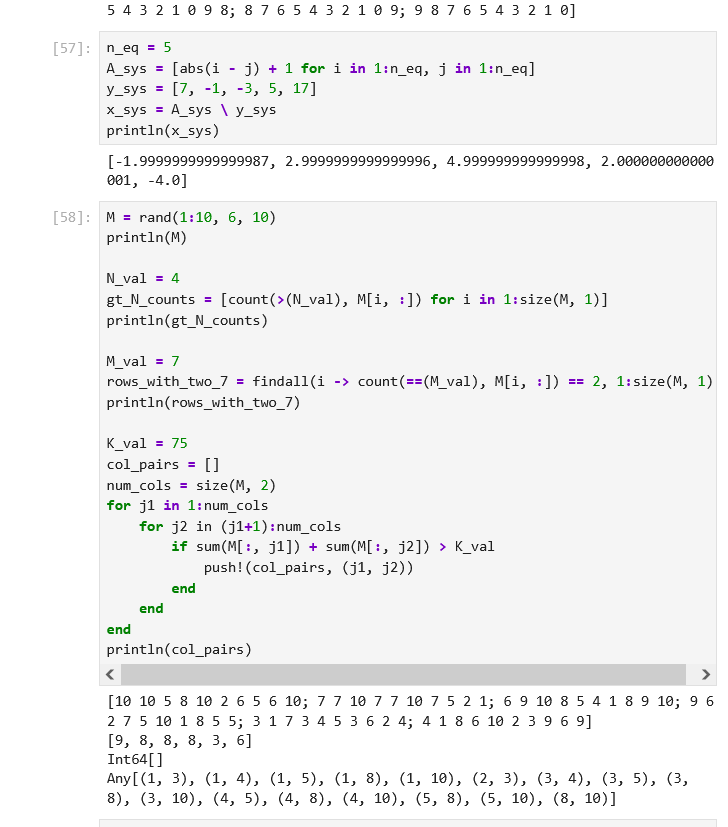{height=55%}

# Слайд 11. Двойные суммы (3.4.11)

* Сумма i⁴/(3+j) ≈ 639215.2833.
* Сумма i⁴/(3+i·j) ≈ 89912.0215.

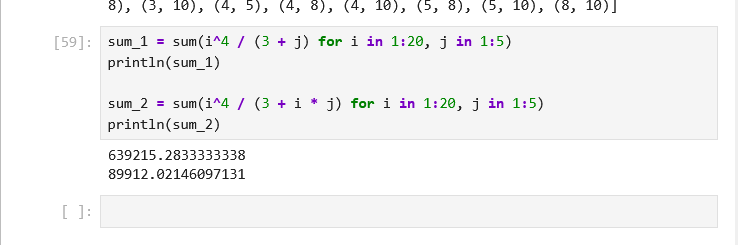{height=55%}

# Ограничения работы

* Не предоставлены скриншоты 3.4.1 (квадраты, словарь, массив) и Z2–Z4 из 3.4.7.
* Матрица M в 3.4.10 не зафиксирована генератором случайных чисел.
* В 3.4.8 требуется исправить A2 и A5 и обобщить outer на матричное умножение.

# Выводы

* Освоены циклы while и for, условные и тернарный операторы, функции.
* Освоены map, broadcast, матричные операции и решение СЛАУ.
* Подключены пакеты Colors и LinearAlgebra.
* Отмечены особенности Julia: A^3 и A.^3 различаются; sort! меняет массив.
