# Титульный лист

**Лабораторная работа № 3. Управляющие структуры**

Студент: Жаворонков Кирилл Александрович

Группа: НПИбд-01-23

Номер студенческого билета: 1132231844

Дисциплина: Компьютерный практикум на языке Julia

# Формулировка задания

**Цель работы.** Освоить применение циклов и функций, сторонних пакетов Julia для решения задач линейной алгебры и работы с матрицами.

**Задание.**

1. Используя JupyterLab, повторить примеры из раздела 3.2 методички.
2. Выполнить задания для самостоятельной работы (раздел 3.4):
   - 3.4.1 — вывод чисел от 1 до 100 и их квадратов, словарь и массив квадратов (циклы `while` и `for`);
   - 3.4.2 — условный оператор и тернарный оператор для чётных и нечётных чисел;
   - 3.4.3 — функция `add_one`;
   - 3.4.4 — матрица, каждый элемент которой больше предыдущего на единицу, через `map` или `broadcast`;
   - 3.4.5 — степень матрицы `A³` и замена третьего столбца суммой второго и третьего;
   - 3.4.6 — матрица `B` и произведение `C = BᵀB`;
   - 3.4.7 — матрицы `Z`, `E` и шаблоны `Z1`–`Z4`;
   - 3.4.8 — собственная функция `outer(x, y, operation)` и матрицы `A1`–`A5`;
   - 3.4.9 — решение системы линейных уравнений с 5 неизвестными;
   - 3.4.10 — случайная матрица `M` размером 6×10 и её анализ;
   - 3.4.11 — вычисление двух двойных сумм.

# Выполнение работы

## Примеры раздела 3.2 (задание 1)

### Циклы `for` и двумерный массив

В JupyterLab выполнены примеры циклов `for`: вывод нечётных чисел с шагом 2 и перебор массива строк.

```julia
for n in 1:2:10
    println(n)
end

myfriends = ["Ted", "Robyn", "Barney", "Lily", "Marshall"]
for friend in myfriends
    println("Hi $friend, it's great to see you!")
end
```

Результат: вывод чисел 1, 3, 5, 7, 9 и приветствий для каждого из пяти имён.

Затем построены двумерные массивы, в которых значение каждой ячейки равно сумме индексов строки и столбца.

```julia
m, n = 5, 5
A = fill(0, (m, n))
for i in 1:m
    for j in 1:n
        A[i, j] = i + j
    end
end
A
```

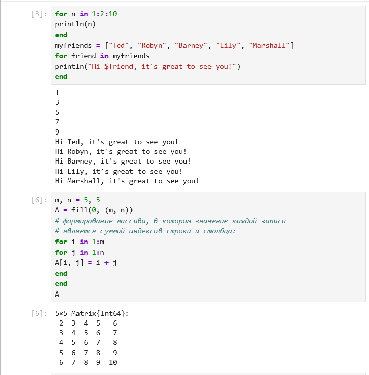{#fig-loops}

Во втором варианте (`B = fill(0, (m, n))`, цикл `for i in 1:m, j in 1:n`) и в генераторе `C = [i + j for i in 1:m, j in 1:n]` получен тот же массив. Результаты совпадают.

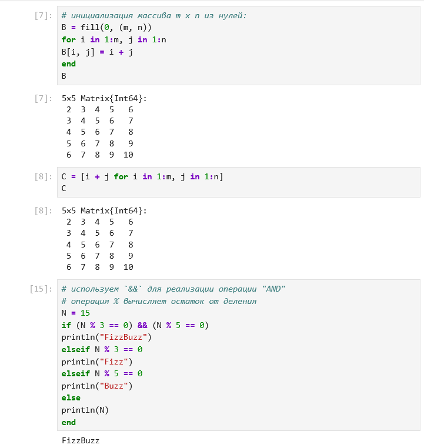{#fig-matrix-variants}

### Условные выражения и тернарный оператор

Проверка FizzBuzz для `N = 15` дала ответ «FizzBuzz», так как число делится и на 3, и на 5.

```julia
N = 15
if (N % 3 == 0) && (N % 5 == 0)
    println("FizzBuzz")
elseif N % 3 == 0
    println("Fizz")
elseif N % 5 == 0
    println("Buzz")
else
    println(N)
end
```

Тернарный оператор `(x > y) ? x : y` при `x = 5`, `y = 10` вернул `10`.

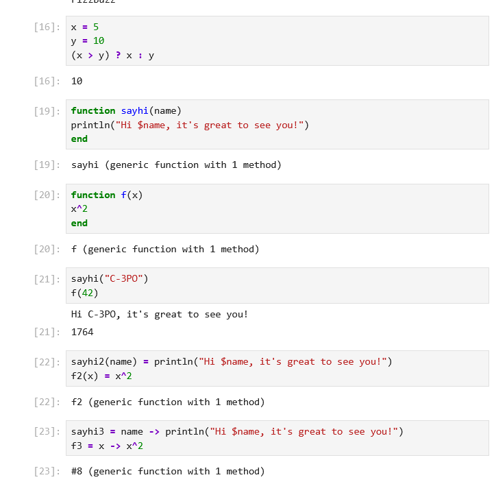{#fig-ternary-functions}

### Функции

Функция `sayhi(name)` выводит приветствие, функция `f(x) = x^2` при `x = 42` даёт `1764`. Также проверены однострочные и анонимные варианты объявления функций.

```julia
function sayhi(name)
    println("Hi $name, it's great to see you!")
end

function f(x)
    x^2
end

sayhi("C-3PO")
f(42)
```

### Сортировка `sort` и `sort!`

Функция `sort!(v)` изменила массив `v` на месте, а `sort(v)` без восклицательного знака вернула новый отсортированный массив и не изменила исходный.

```julia
v = [3, 5, 2]
sort(v)
v
sort!(v)
v
```

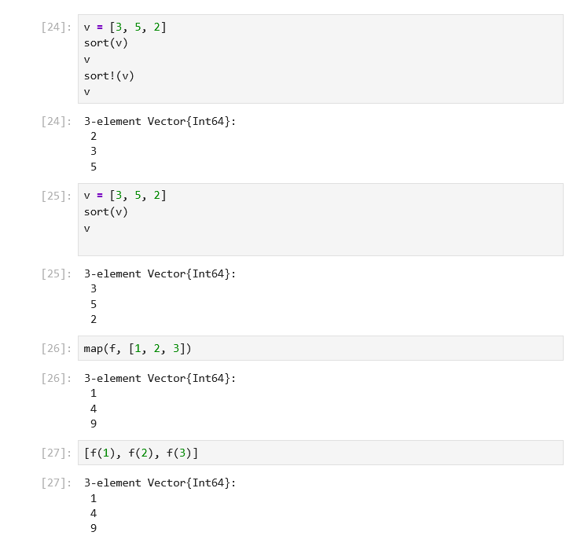{#fig-sort}

### Функции высшего порядка `map` и `broadcast`

Функция `map(f, [1, 2, 3])` даёт `[1, 4, 9]`, `map(x -> x^3, ...)` даёт `[1, 8, 27]`. `broadcast(f, ...)` и `f.(...)` дают тот же результат. Для матрицы `A = [i + 3*j for j in 0:2, i in 1:3]` получена матрица `[1 2 3; 4 5 6; 7 8 9]`.

```julia
f(x) = x^2
map(f, [1, 2, 3])
map(x -> x^3, [1, 2, 3])
broadcast(f, [1, 2, 3])
f.([1, 2, 3])
A = [i + 3*j for j in 0:2, i in 1:3]
```

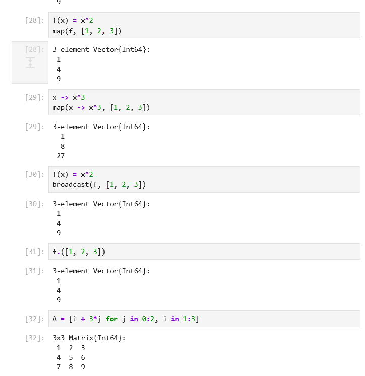{#fig-map-broadcast}

### Пакет Colors

Пакет `Colors` подключён, создана палитра из 100 цветов `distinguishable_colors(100)`. Функция `rand(palette, 3, 3)` возвращает матрицу 3×3 случайных цветов.

```julia
using Colors
palette = distinguishable_colors(100)
rand(palette, 3, 3)
```

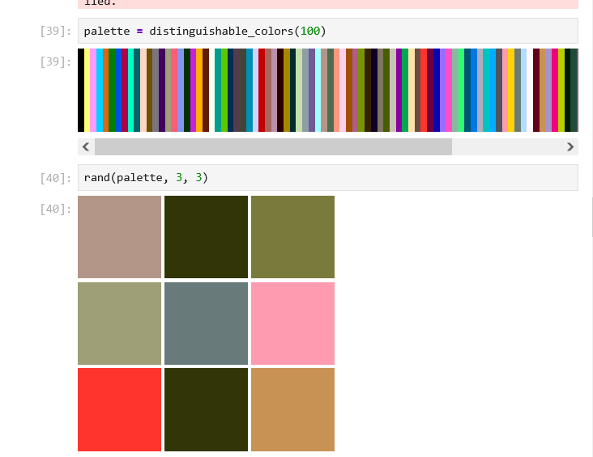{#fig-colors}

## Самостоятельные задания (задание 2)

### 3.4.1. Циклы while и for

[Скриншот не предоставлен. Вставьте результаты выполнения вывода чисел 1–100 с квадратами, словаря `squares` и массива `squares_arr`.]

### 3.4.2. Условный и тернарный операторы

Для чисел 14 и 15 выполнена проверка чётности условным оператором `if`. Результат: для 14 выведено число `14`, для 15 — строка «нечётное». Тот же результат получен тернарным оператором.

```julia
num = 14
if num % 2 == 0
    println(num)
else
    println("нечётное")
end

num % 2 == 0 ? println(num) : println("нечётное")
```

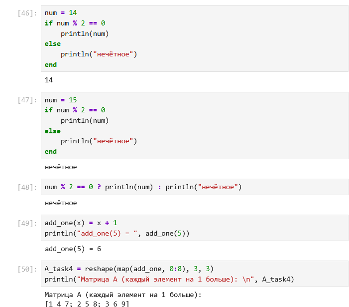{#fig-task-3-4-2}

### 3.4.3. Функция add_one

```julia
add_one(x) = x + 1
println("add_one(5) = ", add_one(5))
```

Результат: `add_one(5) = 6`.

### 3.4.4. Матрица с помощью map

Матрица получена применением `map(add_one, 0:8)` и изменением формы в `3×3`. Результат: `[1 4 7; 2 5 8; 3 6 9]`.

```julia
A_task4 = reshape(map(add_one, 0:8), 3, 3)
```

{#fig-task-3-4-3}

### 3.4.5. Степень матрицы и замена столбца

Матрица `A = [1 1 3; 5 2 6; -2 -1 -3]`. Найдена матричная степень `A^3`, которая оказалась нулевой матрицей. Затем третий столбец заменён суммой второго и третьего.

```julia
A_5 = [1 1 3; 5 2 6; -2 -1 -3]
A_cubed = A_5^3
A_5[:, 3] = A_5[:, 2] + A_5[:, 3]
println(A_5)
```

Результат: `A³ = [0 0 0; 0 0 0; 0 0 0]`, после замены столбца матрица `[1 1 4; 5 2 8; -2 -1 -4]`.

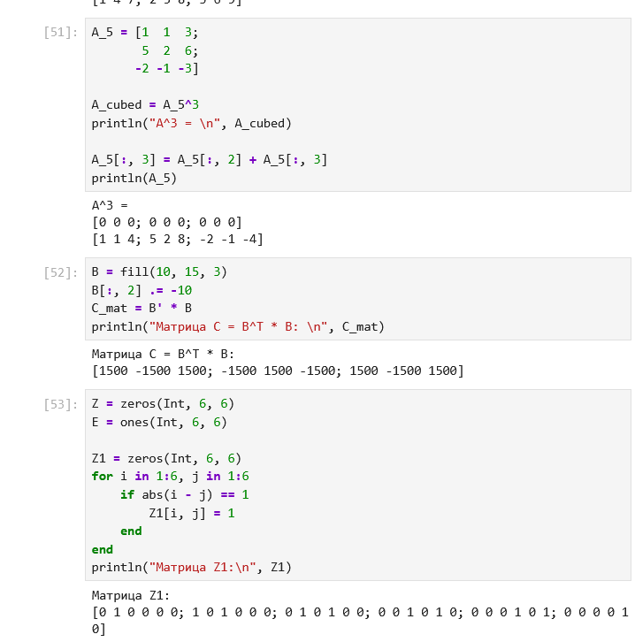{#fig-task-3-4-5}

### 3.4.6. Матрица B и C = BᵀB

```julia
B = fill(10, 15, 3)
B[:, 2] .= -10
C_mat = B' * B
```

Результат: `C = [1500 -1500 1500; -1500 1500 -1500; 1500 -1500 1500]`.

{#fig-task-3-4-6}

### 3.4.7. Матрицы Z, E и Z1

```julia
Z = zeros(Int, 6, 6)
E = ones(Int, 6, 6)
Z1 = zeros(Int, 6, 6)
for i in 1:6, j in 1:6
    if abs(i - j) == 1
        Z1[i, j] = 1
    end
end
Z1
```

Результат для `Z1` совпадает с эталоном из методички: первая строка `[0 1 0 0 0 0]`, вторая `[1 0 1 0 0 0]`.

{#fig-task-3-4-7}

[Скриншоты матриц `Z2`, `Z3`, `Z4` не предоставлены. Вставьте их после выполнения соответствующих ячеек.]

### 3.4.8. Функция outer и матрицы A1–A5

Для построения матриц реализована функция `outer(x, y, operation)`, которая применяет `operation` к каждой паре элементов (`i` из `x`, `j` из `y`).

```julia
function outer(x, y, operation)
    return [operation(i, j) for i in x, j in y]
end

A1 = outer(0:4, 0:4, +)
A2 = outer(0:4, 1:5, (x, y) -> x == 0 ? 0 : x^(y-1))
A3 = outer(0:4, 0:4, (x, y) -> (x + y) % 5)
A4 = outer(0:9, 0:9, (x, y) -> (x + y) % 10)
A5 = outer(1:10, 1:10, (x, y) -> (x - y + 10) % 10)
```

Результаты:

- `A1` — таблица сумм `i + j` для `i, j = 0…4`; совпадает с эталоном.
- `A3` — `(i + j) mod 5`; совпадает с эталоном.
- `A4` — `(i + j) mod 10` размером 10×10; совпадает с эталоном.
- `A2` и `A5` — отличаются от эталона (см. замечания ниже).

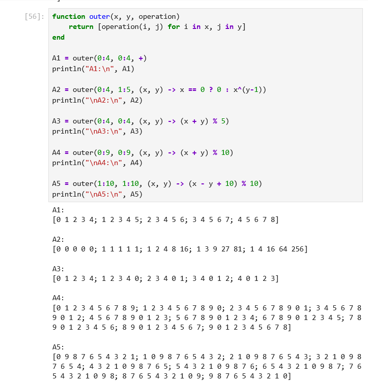{#fig-outer}

**Замечания к результатам 3.4.8:**

- Для `A2` эталон требует `i^j` при `j = 1…5` (вторая строка `2 4 8 16 32`). В реализации используется `x^(y-1)`, что даёт строку `1 2 4 8 16`.
- Для `A5` эталон — матрица 9×9 с элементами `(i − j) mod 9`. В реализации получена матрица 10×10 с `mod 10`.
- Функция `outer` построена как поэлементная операция над парами, а не как обобщение матричного умножения, которое требует задание (`outer(A, B, *)` должна быть эквивалентна `A*B`).

### 3.4.9. Система линейных уравнений

Матрица `A[i,j] = |i − j| + 1`, вектор `y = [7, −1, −3, 5, 17]`.

```julia
n_eq = 5
A_sys = [abs(i - j) + 1 for i in 1:n_eq, j in 1:n_eq]
y_sys = [7, -1, -3, 5, 17]
x_sys = A_sys \ y_sys
println(x_sys)
```

Результат: `x ≈ [−2, 3, 5, 2, −4]` (вычисления в вещественных числах дают погрешности порядка `10⁻¹⁵`, например `−1.9999999999999987`).

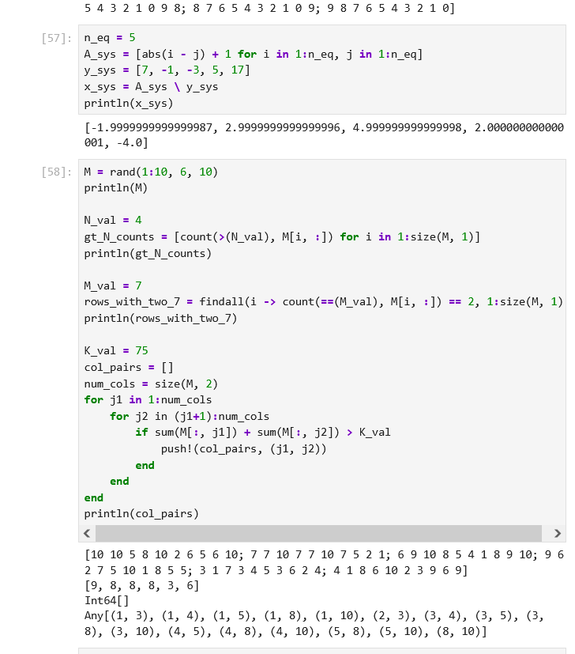{#fig-task-3-4-9}

### 3.4.10. Случайная матрица M

```julia
M = rand(1:10, 6, 10)
N_val = 4
gt_N_counts = [count(>(N_val), M[i, :]) for i in 1:size(M, 1)]

M_val = 7
rows_with_two_7 = findall(i -> count(==(M_val), M[i, :]) == 2, 1:size(M, 1))

K_val = 75
col_pairs = []
num_cols = size(M, 2)
for j1 in 1:num_cols
    for j2 in (j1+1):num_cols
        if sum(M[:, j1]) + sum(M[:, j2]) > K_val
            push!(col_pairs, (j1, j2))
        end
    end
end
```

Результаты для данного запуска (генератор не зафиксирован, поэтому при повторном запуске результаты будут другими):

- число элементов, больших 4, по строкам: `[9, 8, 8, 8, 3, 6]`;
- строки, где число 7 встречается ровно 2 раза: пустой список `[]`;
- пары столбцов с суммой больше 75: `(1,3), (1,4), (1,5), (1,8), (1,10), (2,3), (3,4), (3,5), (3,8), (3,10), (4,5), (4,8), (4,10), (5,8), (5,10), (8,10)`.

Замечание: в условии «сумма пары столбцов» понимается как сумма всех элементов двух столбцов.

{#fig-task-3-4-10}

### 3.4.11. Двойные суммы

```julia
sum_1 = sum(i^4 / (3 + j) for i in 1:20, j in 1:5)
sum_2 = sum(i^4 / (3 + i * j) for i in 1:20, j in 1:5)
```

Результаты: `sum_1 ≈ 639215.2833333338`, `sum_2 ≈ 89912.02146097131`.

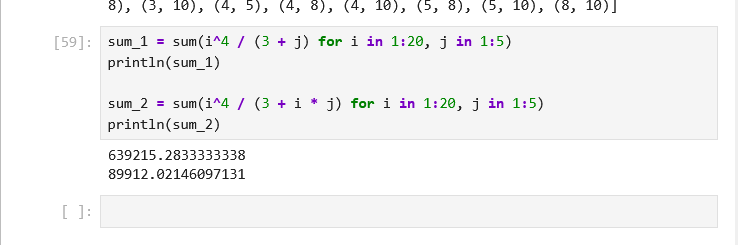{#fig-task-3-4-11}

# Выводы

В ходе лабораторной работы освоены циклы `while` и `for`, условные операторы, тернарный оператор, определение функций, функции высшего порядка `map` и `broadcast`, матричные операции (степень, транспонирование, произведение), решение системы линейных уравнений и подключение пакетов `Colors` и `LinearAlgebra`.

Примеры раздела 3.2 повторены и проверены. Задания 3.4.2–3.4.7, 3.4.9–3.4.11 выполнены, результаты совпадают с ожидаемыми, за исключением замечаний, отмеченных в п. 3.4.8. Для задания 3.4.10 результат зависит от случайного запуска, поэтому для воспроизводимости следует зафиксировать генератор (`Random.seed!`).

Отмечены типичные особенности Julia: `A^3` — матричная степень, а не поэлементная; `sort!` изменяет массив на месте; результаты вещественной арифметики содержат погрешности округления.
