# Формулировка задания

**Цель работы.** Изучить возможности специализированных пакетов Julia для выполнения и оценки эффективности операций над объектами линейной алгебры.

**Задание.**

1. Используя JupyterLab, повторить примеры из раздела 4.2 методички.
2. Выполнить задания для самостоятельной работы (раздел 4.4):
   - 4.4.1 — скалярное и внешнее произведение векторов;
   - 4.4.2 — системы линейных уравнений с двумя и тремя неизвестными;
   - 4.4.3 — диагонализация матриц, степени и корни матриц, собственные значения, диагональная и нижнетреугольная матрицы;
   - 4.4.4 — критерии продуктивности линейных моделей экономики.

# Выполнение работы

## Поэлементные операции и статистика (4.2.1)

Для случайной матрицы `a = rand(1:20, (4, 3))` вычислены суммы и произведения элементов по всей матрице, по столбцам и по строкам, а также средние значения (пакет `Statistics`).

```julia
a = rand(1:20, (4, 3))
sum(a); sum(a, dims=1); sum(a, dims=2)
prod(a); prod(a, dims=1); prod(a, dims=2)
using Statistics
mean(a); mean(a, dims=1); mean(a, dims=2)
```

Результаты: `sum(a) = 159`; `sum(a, dims=1) = [37 55 67]`; `sum(a, dims=2) = [35, 31, 46, 47]`; `prod(a) = 3879876000000`; `mean(a) = 13.25`; `mean(a, dims=1) = [9.25 13.75 16.75]`.

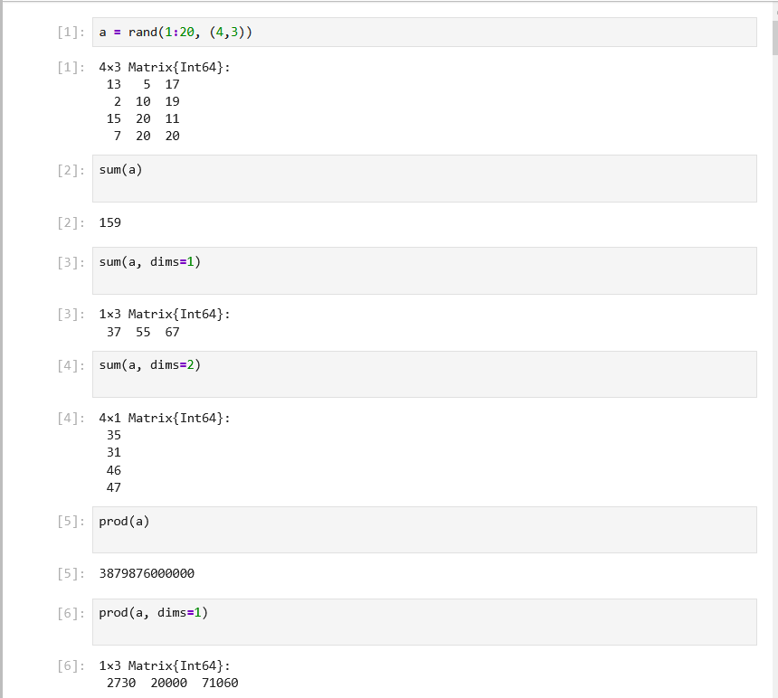{#fig-1}

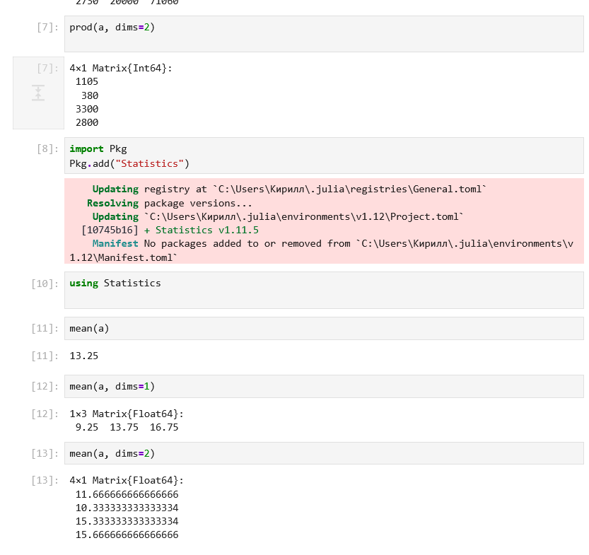{#fig-2}

## Транспонирование, след, ранг, определитель, инверсия (4.2.2)

```julia
using LinearAlgebra
b = rand(1:20, (4, 4))
transpose(b); tr(b); diag(b); rank(b); inv(b); det(b); pinv(b)
```

Результаты: `tr(b) = 33`; `diag(b) = [12, 10, 5, 6]`; `rank(b) = 4`; `det(b) = 15735.0`.

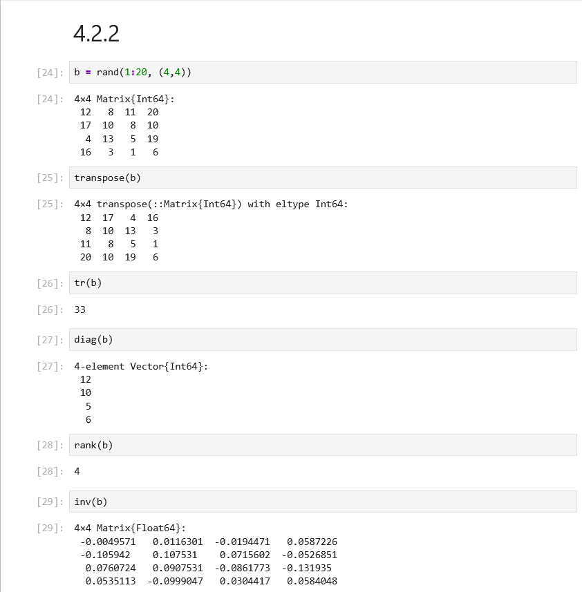{#fig-3}

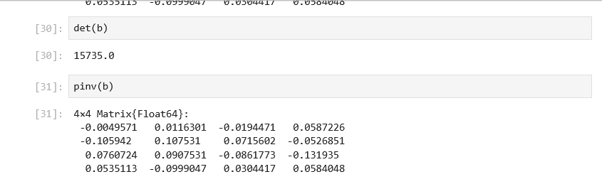{#fig-4}

## Нормы векторов и матриц, повороты (4.2.3)

```julia
X = [2, 4, -5]; Y = [1, -1, 3]
p = 1
norm(X, p)                                  # 11.0
norm(X - Y)                                 # 9.486832980505138
sqrt(sum((X - Y).^2))                       # 9.486832980505138
acos((transpose(X) * Y) / (norm(X) * norm(Y)))   # 2.4404307889469252
d = [5 -4 2; 1 2 3; -2 1 0]
opnorm(d)                                   # 7.0457718132748814
opnorm(d, 1)                                # 8.0
rot180(d); reverse(d, dims=1); reverse(d, dims=2)
```

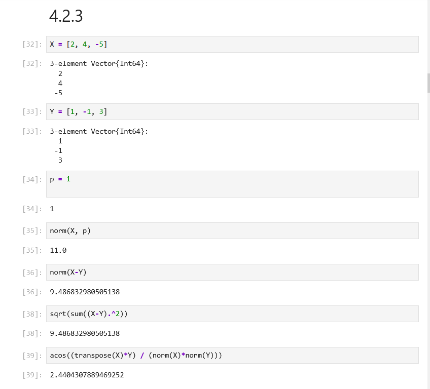{#fig-5}

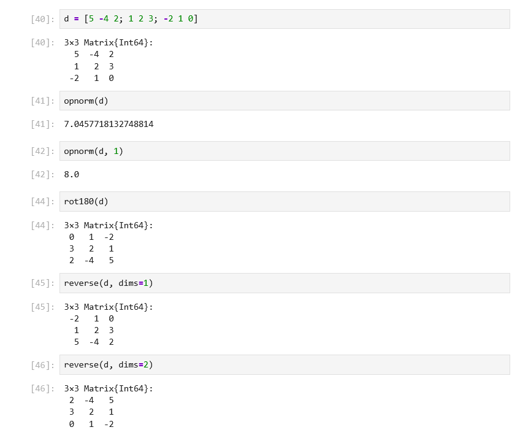{#fig-6}

## Матричное умножение, единичная матрица, скалярное произведение (4.2.4)

```julia
A = rand(1:10, (2, 3)); B = rand(1:10, (3, 4))
A * B
Matrix{Int}(I, 3, 3)
dot(X, Y)     # -17
```

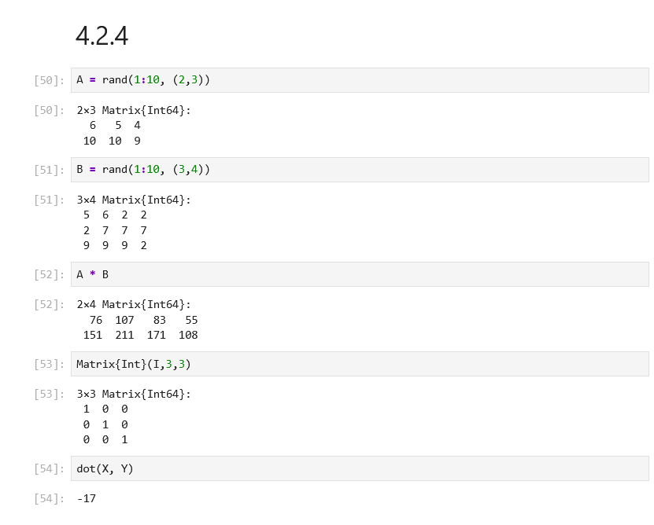{#fig-7}

## Решение СЛАУ, LU- и QR-разложения, спектральное разложение (4.2.5)

Решение системы `A_sq * x = b` с эталонным вектором `x = [1, 1, 1]` через `\` дало значения, близкие к `[1, 1, 1]`.

```julia
A_sq = rand(3, 3)
x_vec = fill(1.0, 3)
b_vec = A_sq * x_vec
A_sq \ b_vec
Alu = lu(A_sq)
Alu.P; Alu.p; Alu.L; Alu.U
Alu \ b_vec
det(A_sq); det(Alu)     # 0.026935400788848776
Aqr = qr(A_sq)
Aqr.Q; Aqr.R
Aqr.Q' * Aqr.Q
Asym = A_sq + A_sq'
AsymEig = eigen(Asym)
AsymEig.values          # [-0.2165, 0.3267, 1.9559]
AsymEig.vectors
inv(AsymEig.vectors) * Asym
```

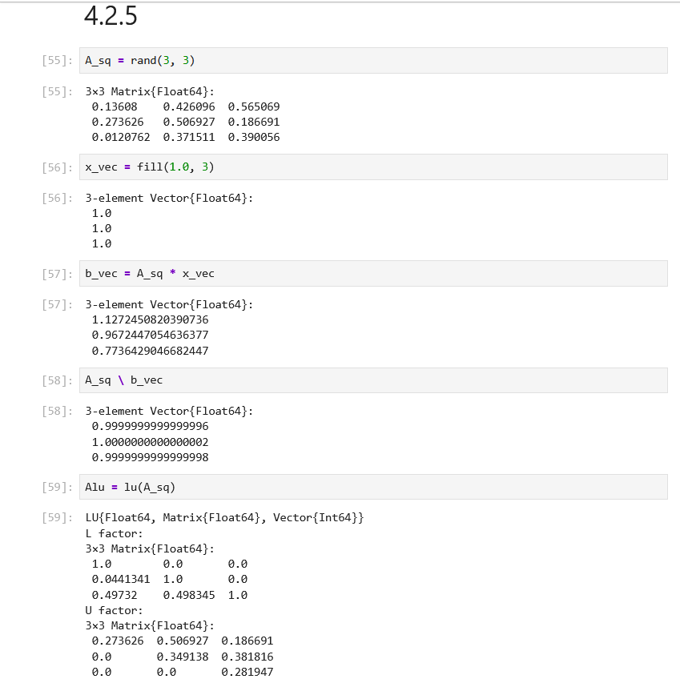{#fig-8}

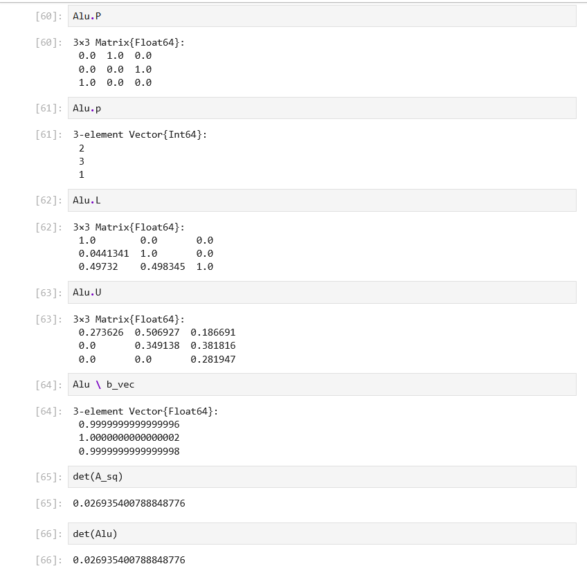{#fig-9}

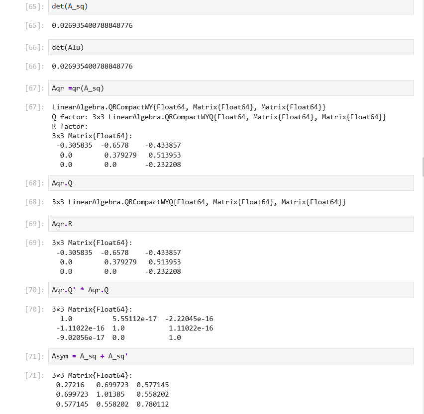{#fig-10}

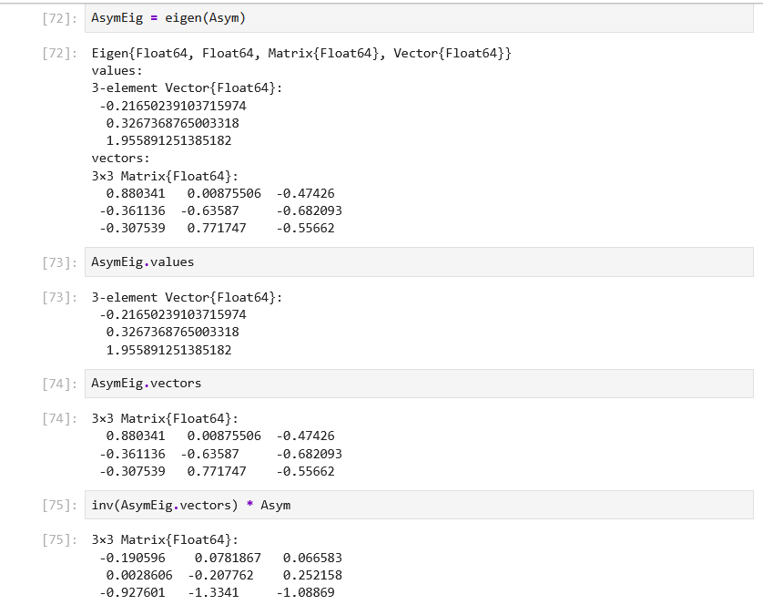{#fig-11}

## Матрицы большого размера (4.2.5)

Для матрицы `1000 × 1000` выполнены симметризация, проверка симметричности, добавление шума и явное указание типа `Symmetric`.

```julia
n = 1000
A_large = randn(n, n)
Asym_large = A_large + A_large'
issymmetric(Asym_large)            # true
Asym_noisy = copy(Asym_large)
Asym_noisy[1, 2] += 5eps()
issymmetric(Asym_noisy)            # false
Asym_explicit = Symmetric(Asym_noisy)
```

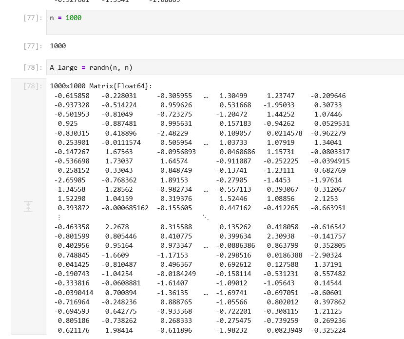{#fig-12}

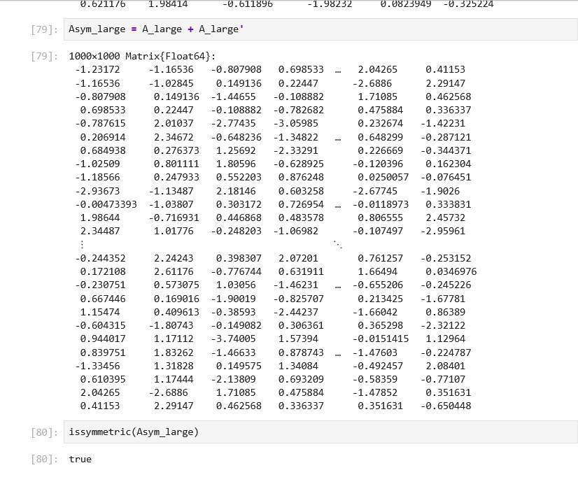{#fig-13}

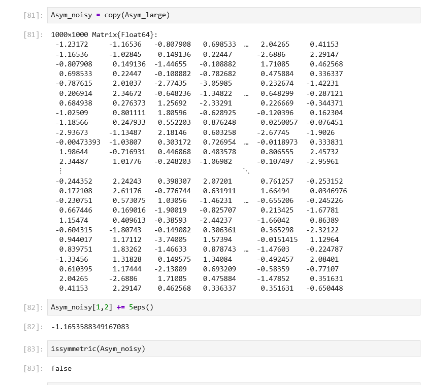{#fig-14}

Оценка времени (`@btime`):

```julia
using BenchmarkTools
@btime eigvals($Asym_large)
@btime eigvals($Asym_noisy)      # 366.536 ms (27 allocations: 7.93 MiB)
@btime eigvals($Asym_explicit)   # 56.033 ms (18 allocations: 7.98 MiB)
```

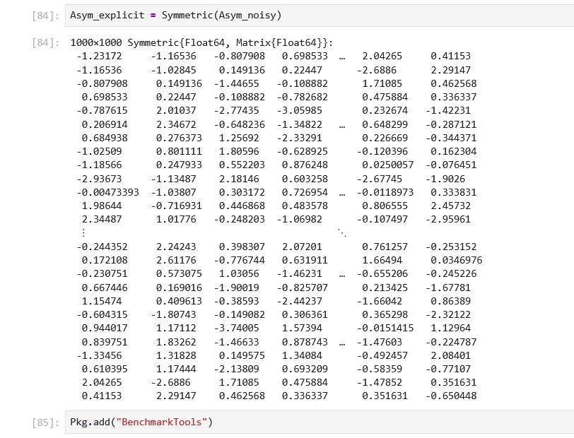{#fig-15}

## Трёхдиагональная матрица (4.2.5)

```julia
n_tri = 1000000
A_tri = SymTridiagonal(rand(n_tri), rand(n_tri - 1))
@btime eigmax($A_tri)            # 471.127 ms (38 allocations: 183.11 MiB)
```

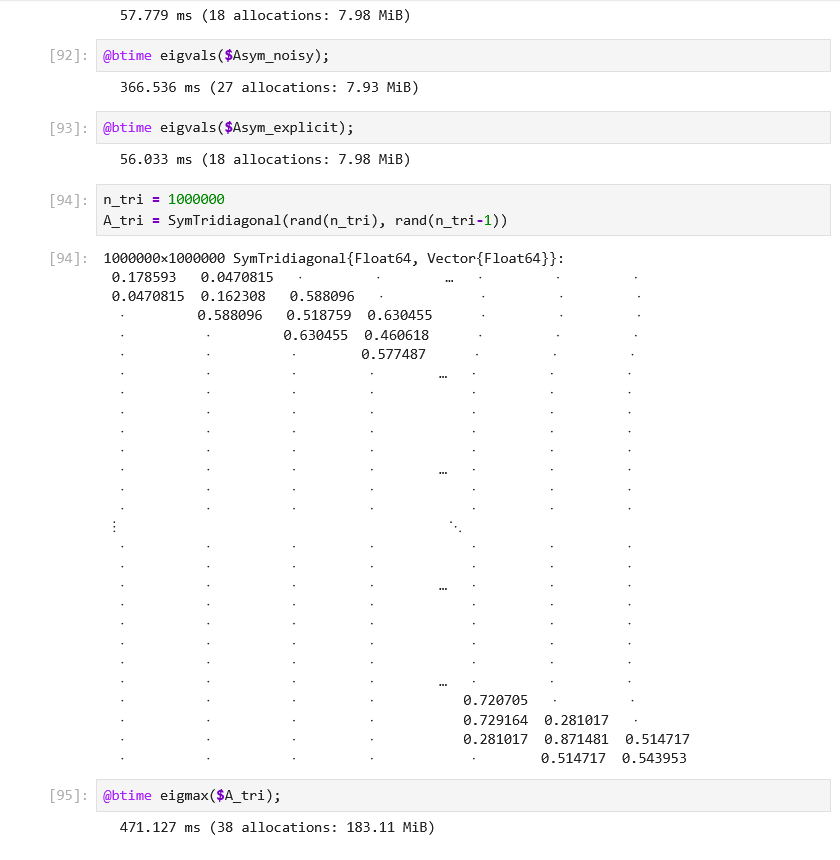{#fig-16}

## Общая линейная алгебра: рациональные числа (4.2.6)

```julia
Arational = Matrix{Rational{BigInt}}(rand(1:10, 3, 3)) // 10
x_rat = fill(1, 3)
b_rat = Arational * x_rat        # [21//10, 11//5, 3//2]
Arational \ b_rat                # [1, 1, 1]
lu(Arational)
```

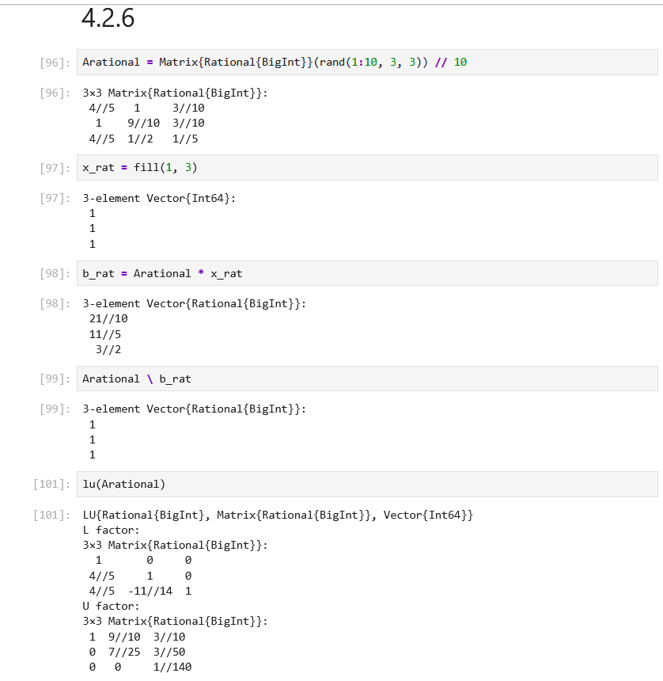{#fig-17}

## Самостоятельная работа 4.4.1 и 4.4.2

**4.4.1.** Вектор `v = [2, 3, 4]`:

```julia
v = [2, 3, 4]
dot_v = dot(v, v)      # 29
outer_v = v * v'
```

Внешнее произведение: `[4 6 8; 6 9 12; 8 12 16]`.

**4.4.2.** Системы решались через `\` и `pinv`:

```julia
x1_a = [1 1; 1 -1] \ [2, 3]
x1_b = pinv([1 1; 2 2]) * [2, 4]
x1_c = pinv([1 1; 2 2]) * [2, 5]
x1_d = [1 1; 2 2; 3 3] \ [1, 2, 3]
x1_e = [1 1; 2 1; 1 -1] \ [2, 1, 3]
x1_f = [1 1; 2 1; 3 2] \ [2, 1, 3]     # [-1.0, 3.0]
x2_a = pinv([1 1 1; 1 -1 -2]) * [2, 3]
x2_b = [1 1 1; 2 2 -3; 3 1 1] \ [2, 4, 1]
x2_c = pinv([1 1 1; 1 1 2; 2 2 3]) * [1, 0, 1]
x2_d = pinv([1 1 1; 1 1 2; 2 2 3]) * [1, 0, 0]   # [0.8333, 0.8333, -1.0]
```

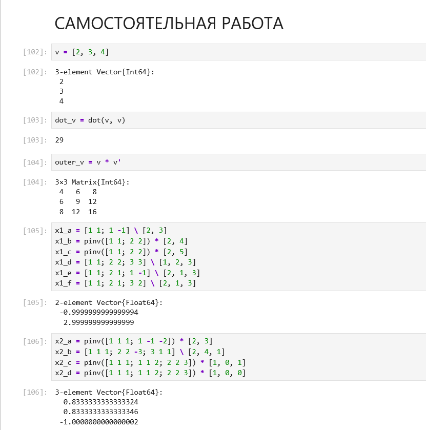{#fig-18}

## Задание 4.4.3. Диагонализация, степени и корни матриц

```julia
diag_a = Diagonal(eigen([1 -2; -2 1]).values)     # diag(-1.0, 3.0)
diag_b = Diagonal(eigen([1 -2; -2 3]).values)     # diag(-0.236068, 4.23607)
diag_c = Diagonal(eigen([1 -2 0; -2 1 2; 0 2 0]).values)
pow_a = [1 -2; -2 1]^10                           # [29525 -29524; -29524 29525]
sqrt_b = sqrt([5 -2; -2 5])
cbrt_c = Complex.([1 -2; -2 1]).^(1/3)
sqrt_d = sqrt([1 2; 2 3])
```

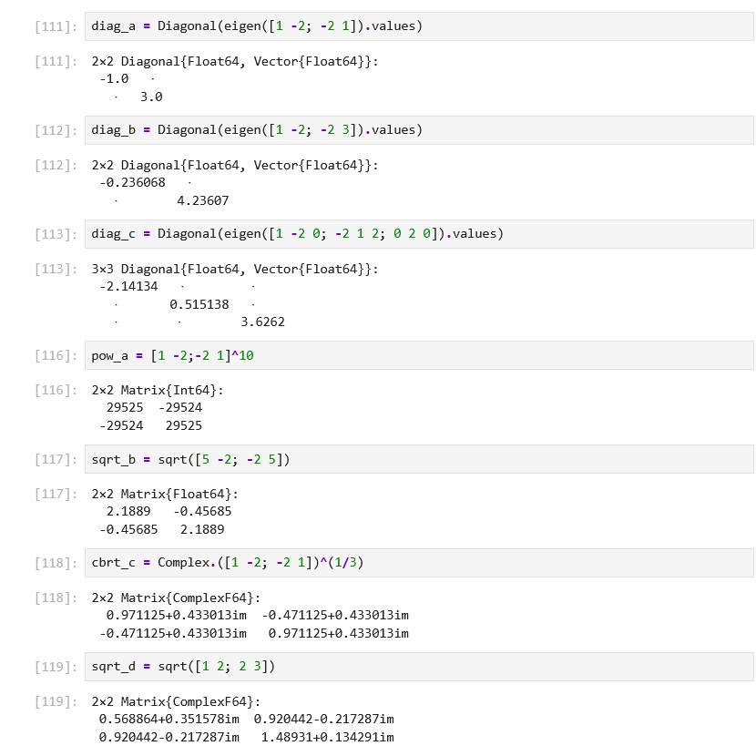{#fig-19}

Для матрицы 5×5 найдены собственные значения `[-128.493, -55.888, 42.752, 87.161, 542.468]`, построены диагональная и нижнетреугольная матрицы:

```julia
A_big = [140 97 74 168 131; 97 106 89 131 36; 74 89 152 144 71;
         168 131 144 54 142; 131 36 71 142 36]
eig_A = eigvals(A_big)
A_diag = Diagonal(eig_A)
A_lower = LowerTriangular(A_big)
@btime eigvals($A_big)     # 2.411 μs (13 allocations: 2.44 KiB)
```

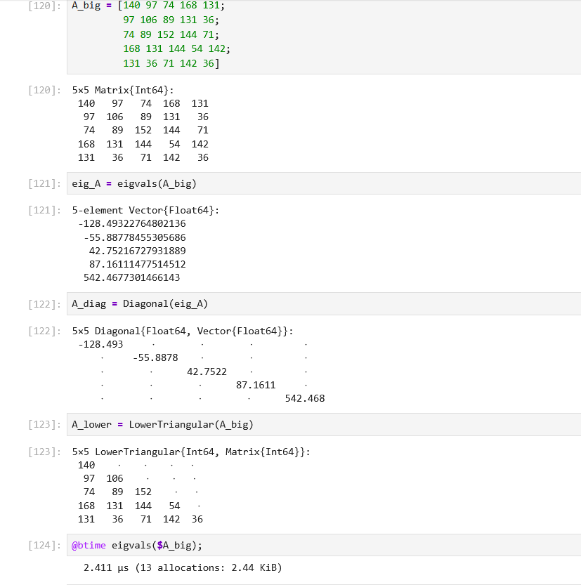{#fig-20}

## Задание 4.4.4. Линейные модели экономики

Реализованы три функции проверки продуктивности: по определению, по критерию `(E − A)⁻¹ ≥ 0` и по спектральному критерию.

```julia
function is_productive_def(A)
    I_mat = Matrix{Float64}(I, size(A,1), size(A,2))
    return all((I_mat - A) \ ones(size(A,1)) .>= 0)
end

function is_productive_crit(A)
    return all(inv(Matrix{Float64}(I, size(A,1), size(A,2)) - A) .>= 0)
end

function is_productive_spectral(A)
    return all(abs.(eigvals(A)) .< 1)
end
```

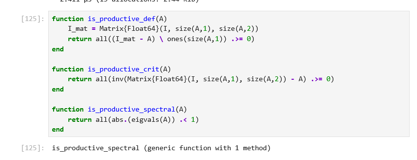{#fig-21}

Результаты проверки:

| Матрица | по определению | по критерию (E−A)⁻¹ | спектральный |
|---|---|---|---|
| (1 2; 3 4), пункт a | false | — | — |
| (1 2; 3 4), пункт b | false | — | — |
| (1 2; 3 4)/10, пункт c | true | — | — |
| (1 2; 3 1) | — | false | false |
| (1 2; 3 1)/2 | — | false | false |
| (1 2; 3 1)/10 | — | true | true |
| (0.1 0.2 0.3; 0 0.1 0.2; 0 0.1 0.3) | — | — | true |

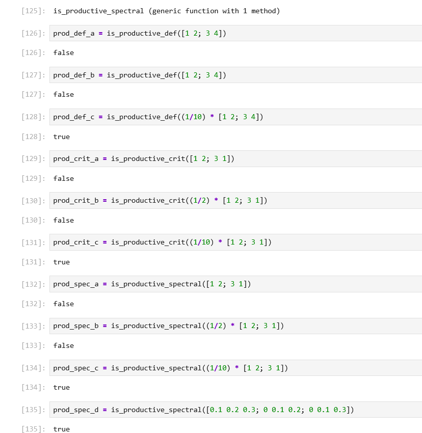{#fig-22}

# Выводы

В ходе лабораторной работы освоены пакеты `Statistics`, `LinearAlgebra` и `BenchmarkTools`. Выполнены поэлементные операции над массивами, вычисление нормы векторов и матриц, операции транспонирования, следа, ранга, определителя и инверсии.

Решены системы линейных уравнений через оператор `\`, построены LU-, QR- и спектральное разложения. Для матриц большого размера оценена эффективность вычислений с использованием типов `Symmetric` и `SymTridiagonal`.

Выполнены задания для самостоятельной работы 4.4.1–4.4.4: скалярное и внешнее произведение векторов, системы линейных уравнений, диагонализация, степени и корни матриц, а также проверка продуктивности линейных моделей экономики тремя критериями.
