# Формулировка задания

**Цель работы.** Изучить возможности пакетов Julia для построения графиков: выбор бэкенда, опции оформления, точечные, полярные, параметрические и трёхмерные графики, линии уровня, векторные поля, погрешности, гистограммы и подграфики.

**Задание.**

1. Используя JupyterLab, повторить примеры из раздела 5.2 методички.
2. Выполнить задания для самостоятельной работы (раздел 5.4):
   - 5.4.1 — все типы графиков для функции sin(x) в одном окне;
   - 5.4.2 — все варианты линий;
   - 5.4.3 — график функции y = π·x²·ln(x) с подписями, цветами и шрифтами;
   - 5.4.5 — два графика одной функции;
   - 5.4.6 — экспериментальные данные с погрешностями;
   - 5.4.7 — точечный график случайных данных;
   - 5.4.8 — трёхмерный точечный график;
   - 5.4.9 — анимация синусоиды;
   - 5.4.11 — эпициклоида.

# Выполнение работы

## Примеры раздела 5.2

### Пример 5.2.1. Подключение пакета и выбор бэкенда

Подключён пакет `Plots`, бэкенд `gr()` использован по умолчанию. Задана функция и данные:

```julia
using Plots
gr()
f(x) = (3x.^2 + 6x .- 9) .* exp.(-0.3x)
x = collect(range(-5, 10, length=151))
y = f(x)
plot(x, y, title = "A simple curve", xlabel = "Variable x", ylabel = "Variable y", color = "blue")
```

На рисунке 1 показан график с английскими подписями в бэкенде `gr`. Затем выбран бэкенд `pyplot()`, что позволило вывести русские подписи (рисунок 2).

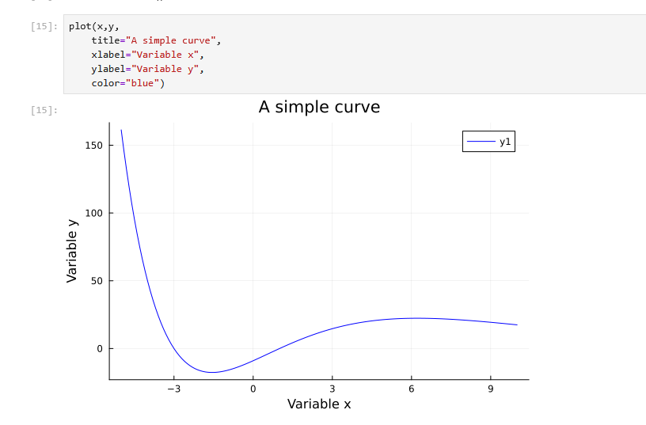{#fig-1}

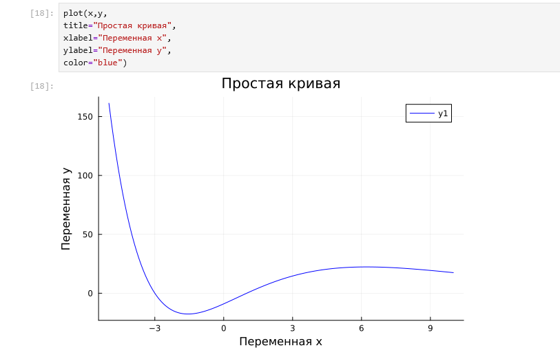{#fig-2}

### Пример 5.2.2. Опции графика и ряд Тейлора

Построен график `sin(x)` на отрезке `[-5, 5]`. Затем определена функция разложения синуса в ряд Тейлора по пяти слагаемым и построен её график:

```julia
sin_theor(x) = sin(x)
plot(sin_theor)
sin_taylor(x) = [(-1)^i*x^(2*i+1)/factorial(2*i+1) for i in 0:4] |> sum
plot(sin_taylor)
plot(sin_theor)
plot!(sin_taylor)
```

Разложение совпадает с синусом вблизи нуля, а при удалении от нуля отклоняется от него (рисунок 4). Наложение двух кривых показано на рисунке 4 в нижней части (ячейка с двумя вызовами `plot`).

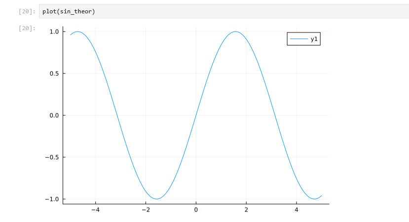{#fig-3}

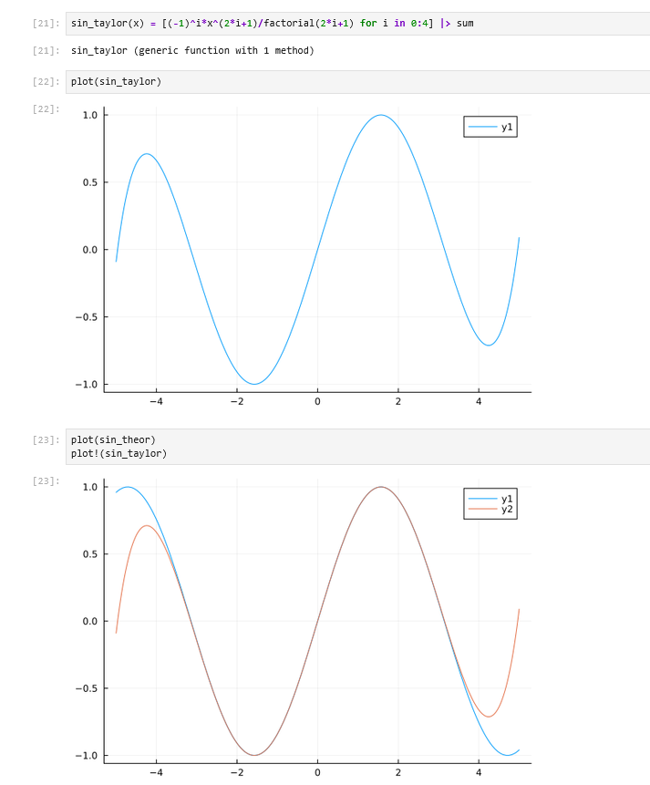{#fig-4}

Далее заданы опции оформления: подписи в легенде, цвет и тип линии, размер графика, отметки по осям, шрифты, заливка области и цвет фона. Результат показан на рисунке 5. Затем на график добавлена штриховая линия теоретического значения `sin(x)` (рисунок 6).

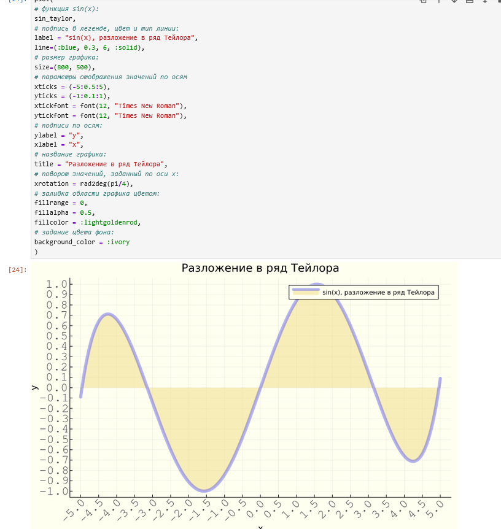{#fig-5}

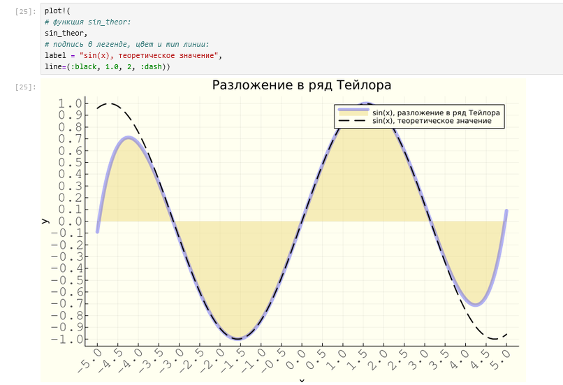{#fig-6}

### Пример 5.2.3. Точечные графики

Построен точечный график по десяти точкам, затем точки с различным размером маркеров и трёхмерный точечный график:

```julia
x = range(1, 10, length=10)
y = rand(10)
plot(x, y, seriestype = :scatter, title = "Точечный график")
n = 50
x = rand(n); y = rand(n); ms = rand(50) * 30
scatter(x, y, markersize = ms)
z = rand(n)
scatter(x, y, z, markersize = ms)
```

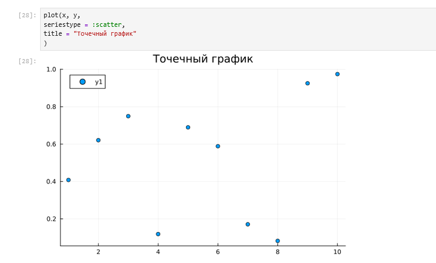{#fig-7}

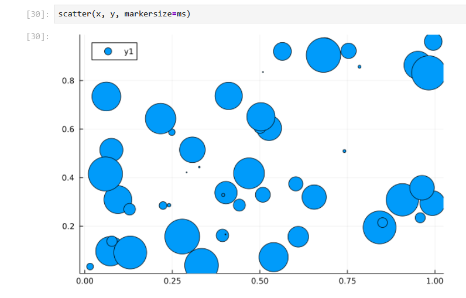{#fig-8}

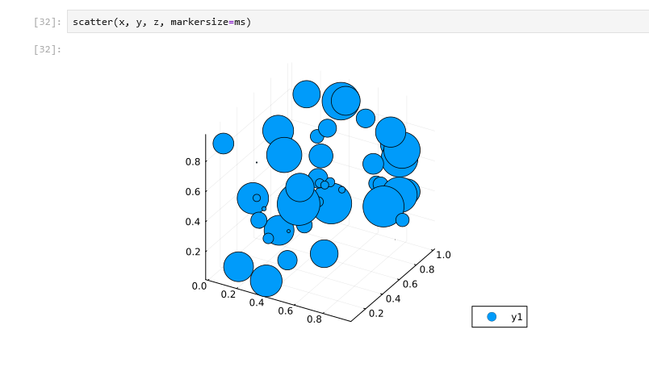{#fig-9}

### Пример 5.2.4. Аппроксимация

Построены зашумлённые данные `y = exp(1 + x) + шум` на отрезке `[0, 10)`. Точки выведены с прозрачностью без легенды. Резкий рост значений в правой части графика соответствует экспоненциальной зависимости.

```julia
x = collect(0:0.01:9.99)
y = exp.(ones(1000) + x) + 4000 * randn(1000)
scatter(x, y, markersize = 3, alpha = 0.8, legend = false)
```

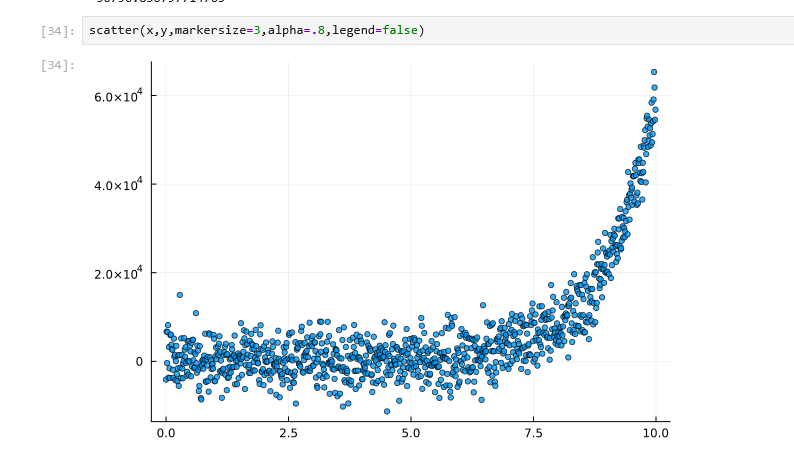{#fig-10}

### Пример 5.2.5. Две оси ординат

Построены два ряда случайных данных с разными масштабами. Вторая ось ординат создана функцией `twinx()`, легенда перенесена в другие углы.

```julia
plot(randn(100), ylabel="y1", leg=:topleft)
plot!(twinx(), randn(100).*10, c=:red, ylabel="y2", leg=:bottomright)
```

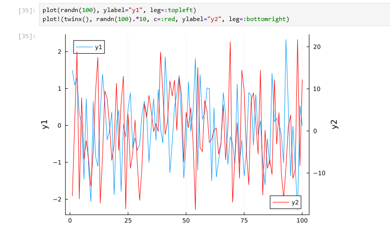{#fig-11}

### Пример 5.2.6. Полярные координаты

Построена полярная кривая `r = 1 + cos(θ)·sin²(θ)`:

```julia
theta = range(0, 2pi, length=100)
r_polar(t) = 1 + cos(t) * sin(t)^2
plot(theta, r_polar.(theta), proj=:polar, title="Полярные координаты")
```

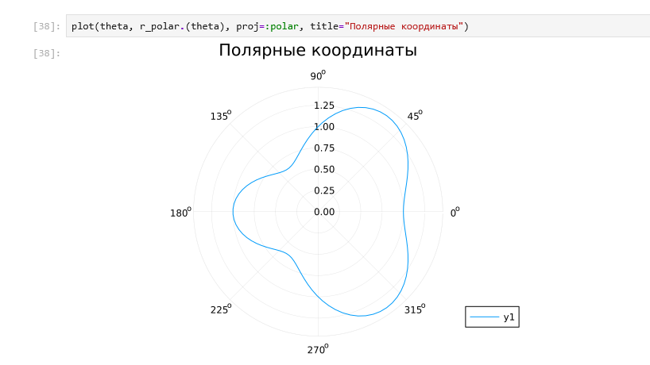{#fig-12}

### Пример 5.2.7. Параметрические графики

Построены параметрические кривые в трёхмерном и двумерном представлении:

```julia
plot(cos.(theta.*5), sin.(theta.*5), sin.(theta.*25), title="Параметрический 3D")
plot(sin.(theta), sin.(2 .* theta), title="Параметрический 2D")
```

Двумерная кривая имеет форму «восьмёрки» (рисунок 14).

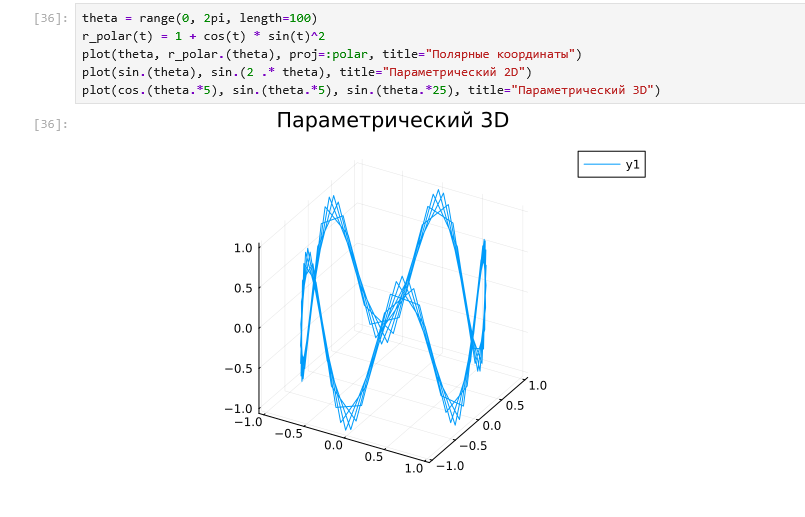{#fig-13}

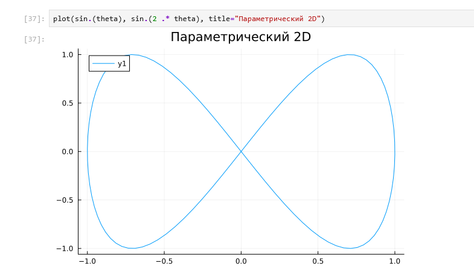{#fig-14}

### Пример 5.2.8. Поверхность

Построена поверхность `f(x, y) = x² + y²` на сетке `[-10, 10]`:

```julia
f(x,y) = x^2 + y^2
x = -10:10
y = x
surface(x, y, f, camera=(30, 45))
```

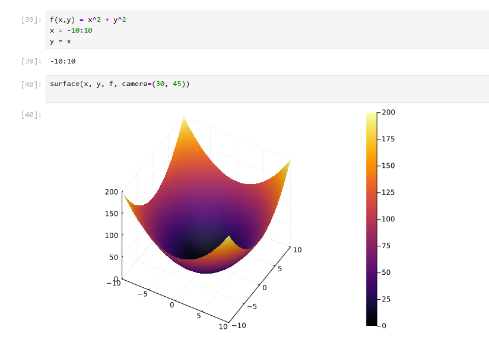{#fig-15}

### Пример 5.2.9. Линии уровня

Для той же функции построены линии уровня с заливкой:

```julia
contour(x, y, f, fill=true)
```

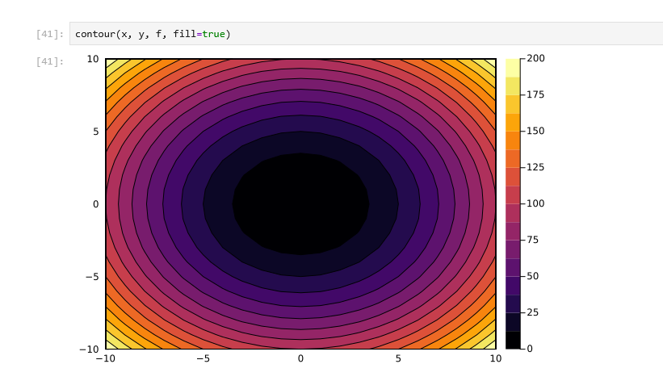{#fig-16}

### Пример 5.2.10. Векторное поле

Построено векторное поле функции `h(x, y) = x³ − 3x + y²`. Компоненты поля заданы градиентом `dh`, масштабированным на 20:

```julia
h_val(x,y) = x^3 - 3x + y^2
dh(x,y) = [3x^2 - 3, 2y] ./ 20
X_grid = -2:0.5:2; Y_grid = -2:0.5:2
quiver(X_grid, Y_grid, quiver=dh, c=:blue, title="Векторное поле")
```

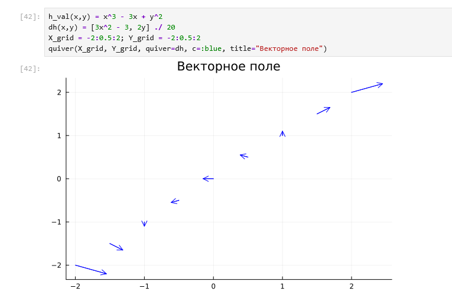{#fig-17}

### Пример 5.2.12. Погрешности (errorbars)

Построены графики `y` с ограничением по оси ординат и с погрешностями по разным осям:

```julia
plot(y, ylims = (-1, 1))
plot(y, ylims = (-1, 1), err = errs)
plot(y, 1:length(y), xerr = errs, marker = stroke(3, :orange))
plot(y, ribbon = errs, fill = :cyan)
plot(x, y, xerr = xerr, yerr = yerr, marker = stroke(2, :orange))
plot(x, y, xerr = (0.5xerr, 2xerr), yerr = (0.5yerr, 2yerr), marker = stroke(2, :orange))
```

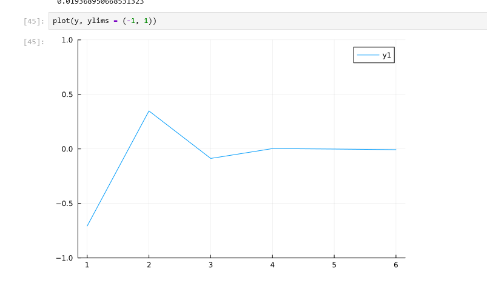{#fig-18}

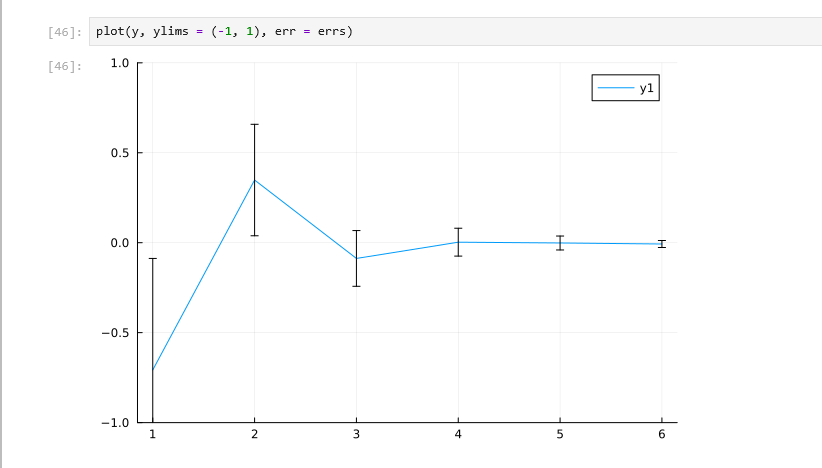{#fig-19}

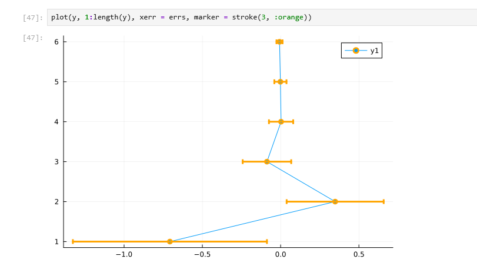{#fig-20}

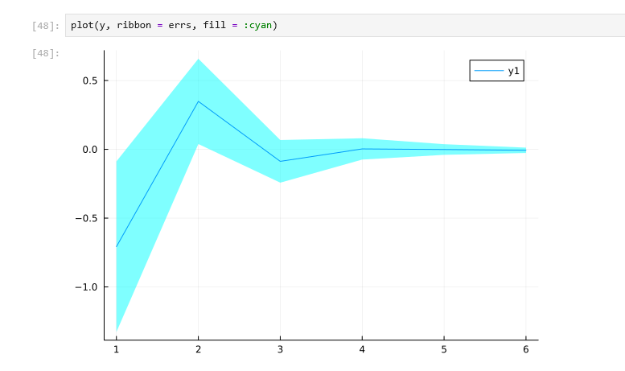{#fig-21}

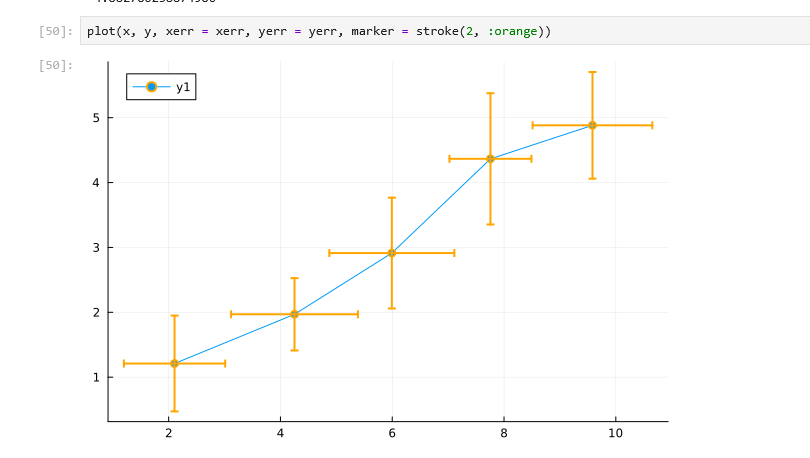{#fig-22}

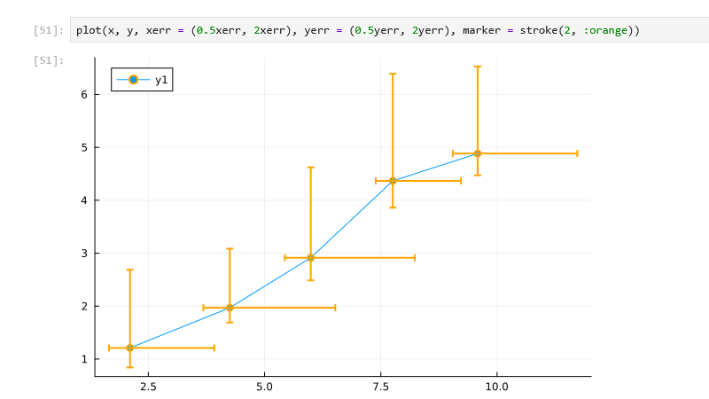{#fig-23}

### Пример 5.2.13. Гистограммы

Построена гистограмма распределения возрастов. Сначала использовано автоматическое число столбцов, затем `bins = 50`:

```julia
histogram(ages, label = "Распределение по возрастам (года)",
          xlabel = "Возраст (лет)", ylabel = "Количество")
histogram(ages, bins = 50, label = "Распределение по возрастам (года)",
          xlabel = "Возраст (лет)", ylabel = "Количество",
          title = "Распределение по возрастам (года)")
```

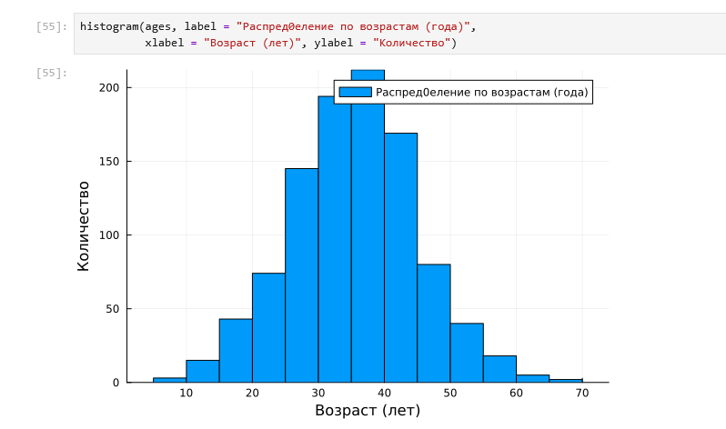{#fig-24}

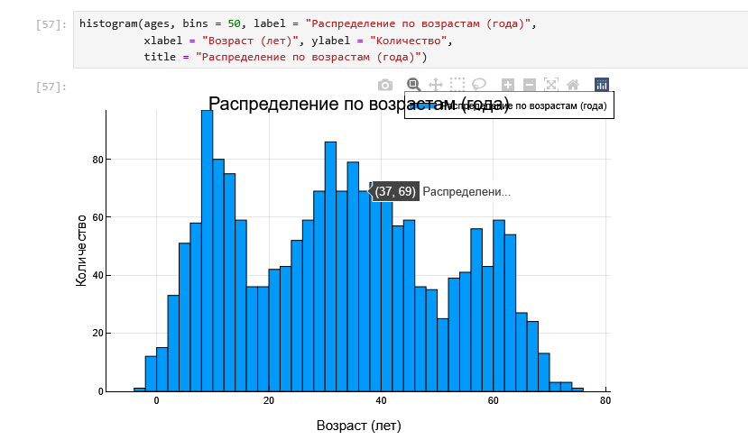{#fig-25}

### Пример 5.2.14. Подграфики

Подграфики созданы параметром `layout`. Сначала построены четыре графика в столбец, затем сетка 2×2. Далее заданы высоты строк сетки и построены графики разных типов, которые объединены в одно окно:

```julia
plot(x, y, layout = (4, 1))
plot(x, y, layout = 4)
plot(x, y, size = (600, 300), layout = grid(4, 1, heights = [0.2, 0.3, 0.4, 0.1]))
p1 = plot(x, y)
p2 = scatter(x, y)
p3 = plot(x, y[:, 1:2], xlabel = "Labelled plot of two columns", lw = 2, title = "Wide lines")
p4 = histogram(x, y)
plot(p1, p2, p3, p4, layout = (2, 2), legend = false, size = (800, 600), background_color = :ivory)
```

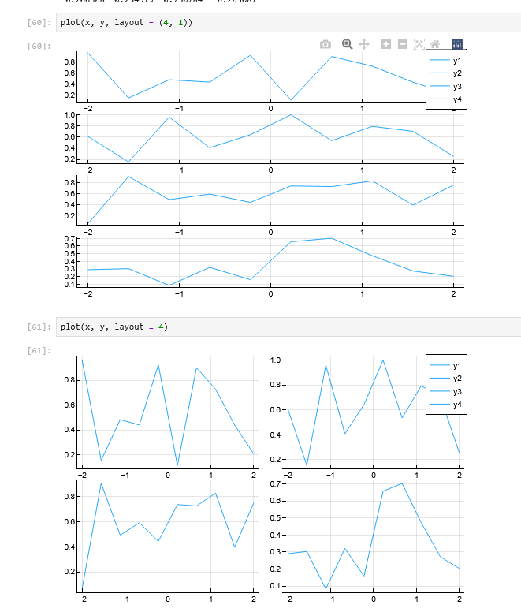{#fig-26}

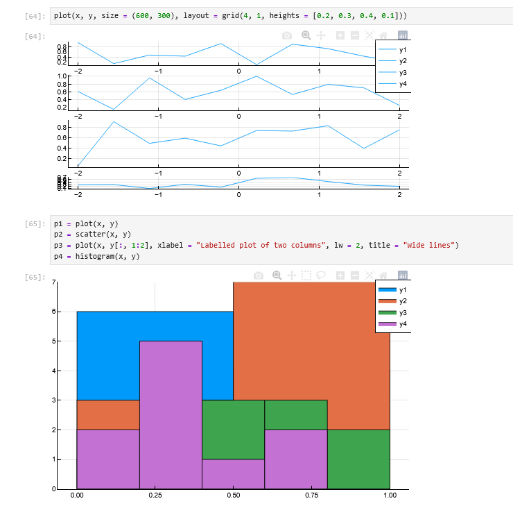{#fig-27}

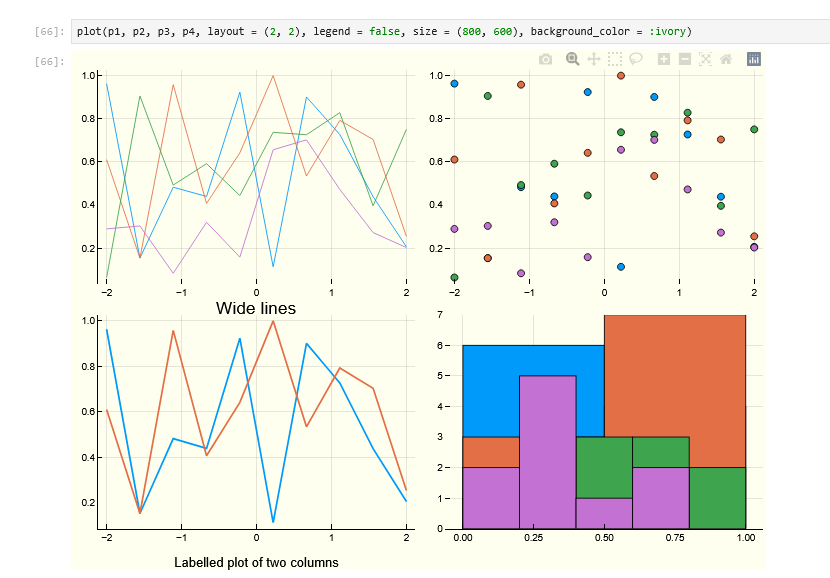{#fig-28}

## Задания для самостоятельной работы (раздел 5.4)

### Задание 5.4.1. Все типы графиков для sin(x)

Для функции `sin(x)` на отрезке `[0, 2π]` построены графики типов `plot`, `scatter`, `sticks`, `step`, `bar`, `histogram`, `path`, `steppost` и `sticks` с маркерами. Все графики выведены в одном окне:

```julia
x = range(0, 2π, length = 50)
y = sin.(x)
p1 = plot(x, y, title = "plot")
p2 = scatter(x, y, title = "scatter")
p3 = plot(x, y, seriestype = :sticks, title = "sticks")
p4 = plot(x, y, seriestype = :step, title = "step")
p5 = bar(x, y, title = "bar")
p6 = histogram(y, title = "histogram")
p7 = plot(x, y, seriestype = :path, title = "path")
p8 = plot(x, y, seriestype = :steppost, title = "steppost")
p9 = plot(x, y, seriestype = :sticks, marker = :circle, title = "sticks+marker")
plot(p1, p2, p3, p4, p5, p6, p7, p8, p9, layout = (3, 3), legend = false, size = (1000, 800))
```

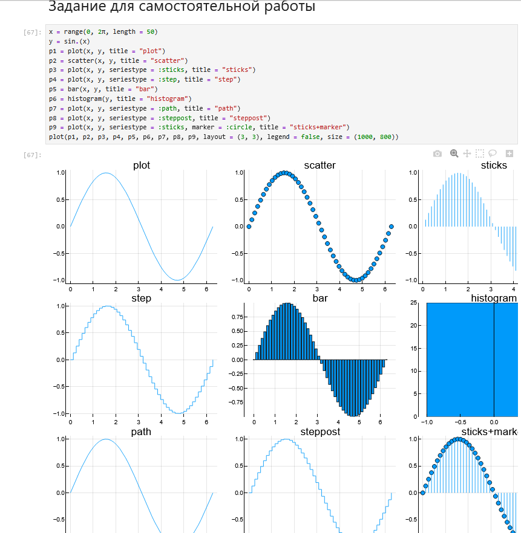{#fig-29}

### Задание 5.4.2. Все варианты линий

Построены пять графиков `sin(x)` с типами линий `solid`, `dash`, `dot`, `dashdot`, `dashdotdot`, расположенных в одном окне:

```julia
styles = [:solid, :dash, :dot, :dashdot, :dashdotdot]
x = range(0, 2π, length = 50)
p = plot(layout = (length(styles), 1), legend = false, size = (700, 900))
for (i, s) in enumerate(styles)
    plot!(p[i], x, sin.(x), linestyle = s, linewidth = 2, title = string(s))
end
p
```

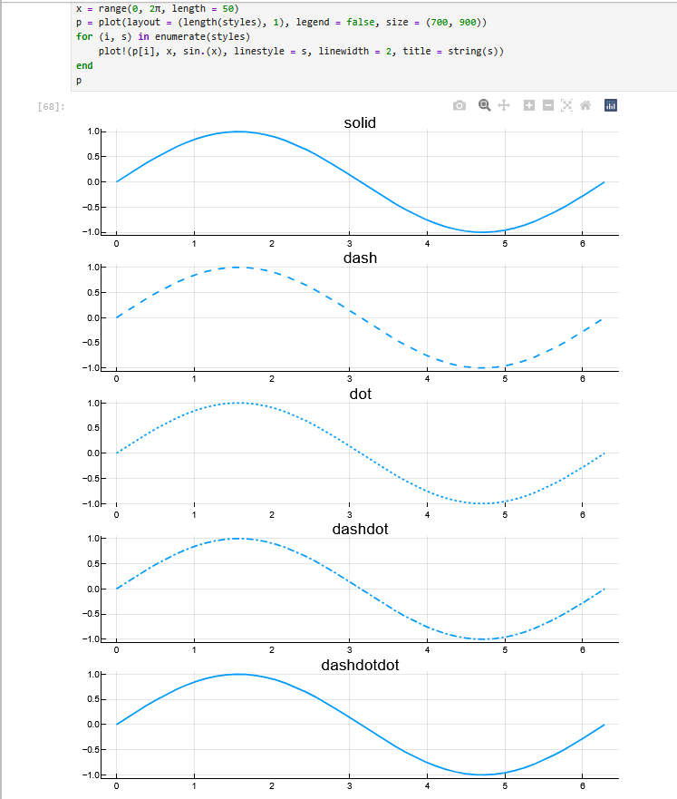{#fig-30}

### Задание 5.4.3. График y = π·x²·ln(x)

Построен график функции `y = π·x²·ln(x)` с подписями осей, красной линией, рамкой `:box`, зелёным фоном вне области графика, шрифтом Arial, размером подписей 12 и шагом отметок 0.5 по оси `x`:

```julia
x = range(0.1, 5, length = 200)
y = π .* x.^2 .* log.(x)
plot(x, y,
    xlabel = "x", ylabel = "y",
    color = :red,
    framestyle = :box,
    background_color_outside = :green,
    xtickfont = font(12, "Arial"), ytickfont = font(12, "Arial"),
    guidefontsize = 12,
    xticks = 0:0.5:5,
    title = "y = π x² ln(x)")
```

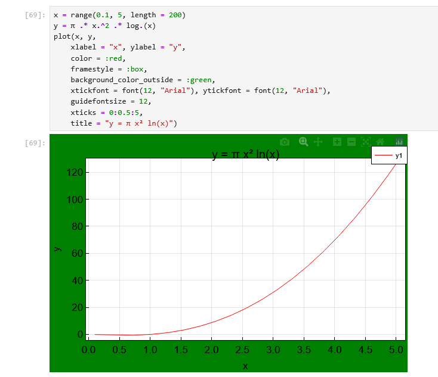{#fig-31}

### Задание 5.4.5. Два графика одной функции

Построены графики `y1 = πx` и `y2 = exp(x)·cos(x)` на отрезке `[3, 6]` в одном окне с одной осью ординат, легендой и сеткой:

```julia
x = range(3, 6, step = 0.1)
y1 = π .* x
y2 = exp.(x) .* cos.(x)
plot(x, y1, label = "πx", color = :blue, legend = :topleft, grid = true)
plot!(x, y2, label = "exp(x)·cos(x)", color = :red)
```

Недостаток такого вывода: значения `y2` достигают порядка 10², поэтому график `y1` выглядит почти горизонтальным. Для сравнения масштабов удобнее использовать две оси ординат.

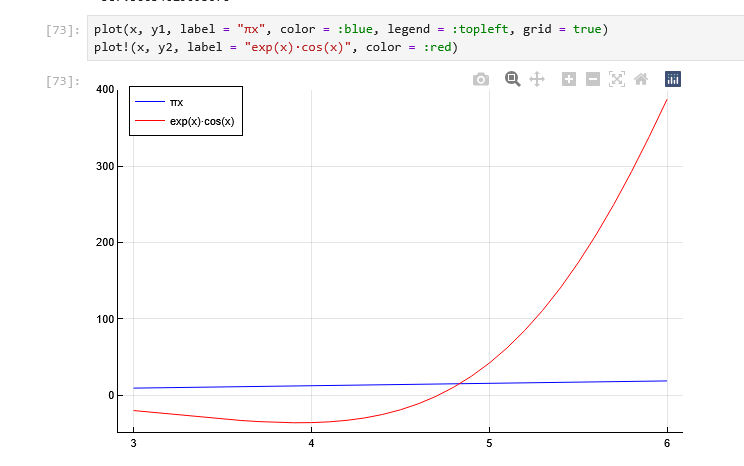{#fig-32}

### Задание 5.4.6. Экспериментальные данные с погрешностями

Использованы 10 точек `y = 2x + шум`, зафиксирован генератор `Random.seed!(2025)`, погрешность каждого измерения равна `0.8`:

```julia
using Random
Random.seed!(2025)
x = collect(1:10)
y = 2 .* x .+ randn(10)
err = fill(0.8, 10)
scatter(x, y, yerr = err, label = "измерения", xlabel = "x", ylabel = "y",
        title = "Экспериментальные данные")
```

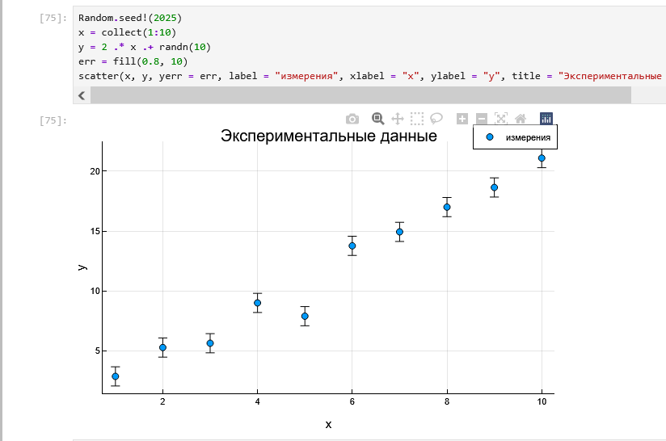{#fig-33}

### Задание 5.4.7. Точечный график случайных данных

Построен точечный график 30 случайных точек в диапазоне `[0, 1]`:

```julia
x = rand(30); y = rand(30)
scatter(x, y, xlabel = "x", ylabel = "y", label = "случайные точки", title = "Точечный график")
```

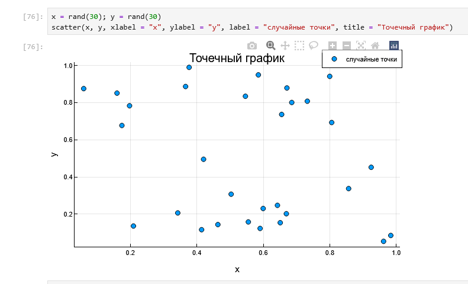{#fig-34}

### Задание 5.4.8. Трёхмерный точечный график

Построен трёхмерный график 50 случайных точек с подписями осей:

```julia
x = rand(50); y = rand(50); z = rand(50)
scatter(x, y, z, xlabel = "x", ylabel = "y", zlabel = "z",
        label = "точки", title = "3D точечный график")
```

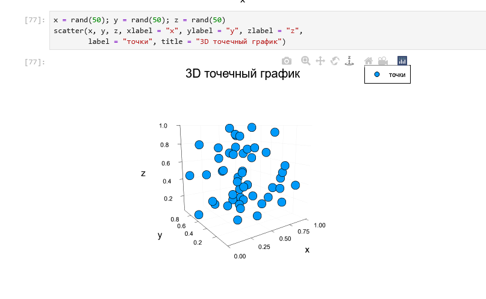{#fig-35}

### Задание 5.4.9. Анимация синусоиды

Построена анимация функции `sin(x + φ)`, где `φ` меняется от `0` до `2π` в 60 кадрах. Анимация сохранена в файл `sine.gif`:

```julia
gr()
x = range(0, 2π, length = 200)
anim = @animate for φ in range(0, 2π, length = 60)
    plot(x, sin.(x .+ φ), ylims = (-1.2, 1.2), label = "sin(x + φ)",
         title = "φ = $(round(φ, digits=2))")
end
gif(anim, "sine.gif", fps = 20)
```

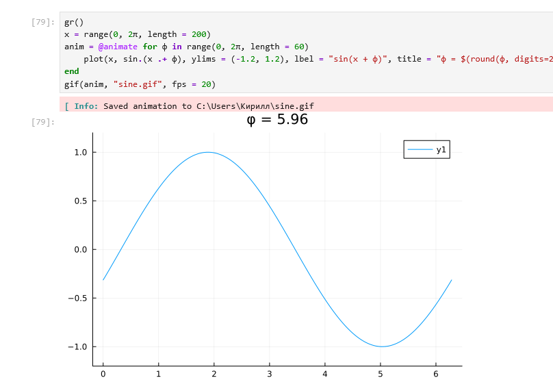{#fig-36}

### Задание 5.4.11. Эпициклоида

Эпициклоида — кривая, которую описывает точка окружности радиуса `r`, катящейся по внешней стороне неподвижной окружности радиуса `R`. Параметр `k = R/r`. В работе использована стандартная параметризация:

$$x(t) = r(k+1)\cos t - r\cos((k+1)t), \qquad y(t) = r(k+1)\sin t - r\sin((k+1)t).$$

Для целого `k = 3` при `r = 1` построена кривая на отрезке `t ∈ [0, 2π]`:

```julia
gr()
r = 1; k = 3
t = range(0, 2π, length = 200)
x = r*(k+1)*cos.(t) .- r*cos.((k+1)*t)
y = r*(k+1)*sin.(t) .- r*sin.((k+1)*t)
plot(x, y, aspect_ratio = 1, legend = false, title = "Эпициклоида, k = $k")
```

Кривая имеет три выступа, что соответствует `k = 3`.

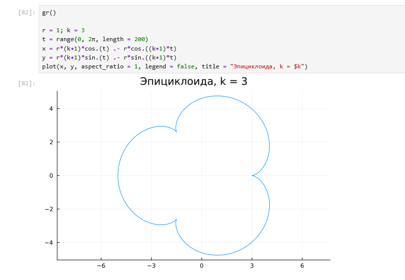{#fig-37}

# Выводы

В ходе работы освоены пакеты Julia для построения графиков: `Plots` с бэкендами `gr` и `pyplot`, а также пакеты `Statistics` и `Distributions`. Изучены опции оформления графиков, точечные и трёхмерные графики, полярные и параметрические кривые, поверхности, линии уровня, векторные поля, погрешности, гистограммы и подграфики. Выполнены задания 5.4.1–5.4.3, 5.4.5–5.4.9 и 5.4.11.
