---
author:
  name: Жаворонков Кирилл Александрович
title: "Лабораторная работа"
subtitle: "Номер 6"
license: CC BY
date: today
date-format: "YYYY-MM-DD"
lang: ru-RU
format:
  pptx:
    toc: false
  pdf:
    toc: false
---

# Докладчик

* Жаворонков Кирилл Александрович
* Студент
* Группа: НПИбд-01-23
* Номер студенческого билета: 1132231844

# Цель работы

* Освоить пакеты Julia для решения задач в непрерывном и дискретном времени.
* Выполнить примеры раздела 6.2 и задания 6.4.1–6.4.8.

# Пример 6.2.1.1. Экспоненциальный рост

* Численное решение ОДУ совпадает с аналитическим u(t) = u0·exp(a·t).

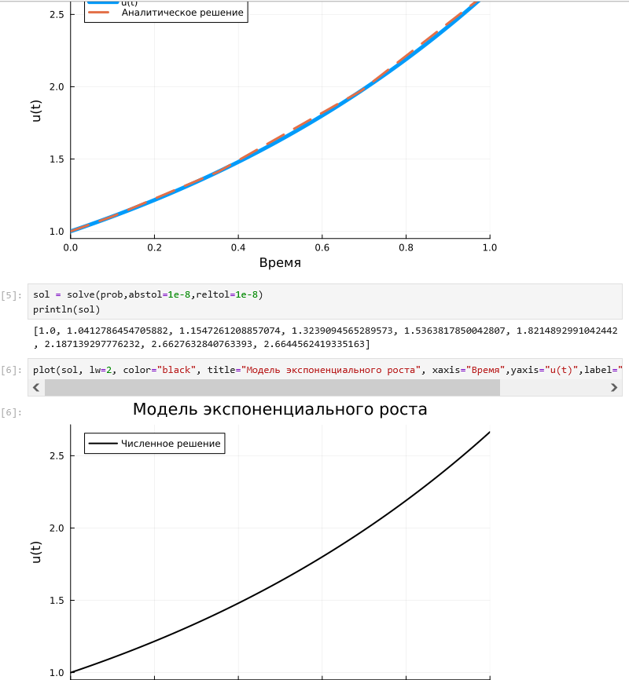{height=55%}

# Пример 6.2.1.2. Аттрактор Лоренца

* Система Лоренца при σ = 10, ρ = 28, β = 8/3.

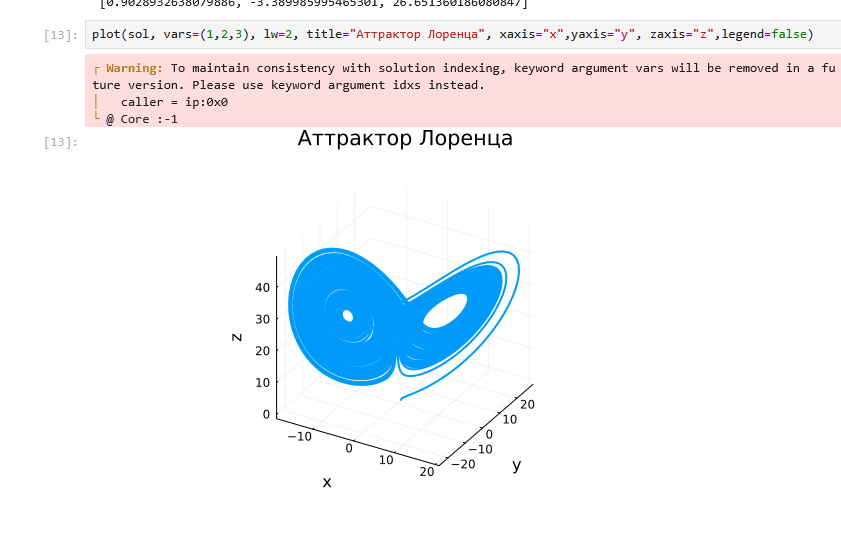{height=55%}

# Пример 6.2.2. Модель Лотки–Вольтерры

* Колебания численности жертв и хищников и фазовый портрет.

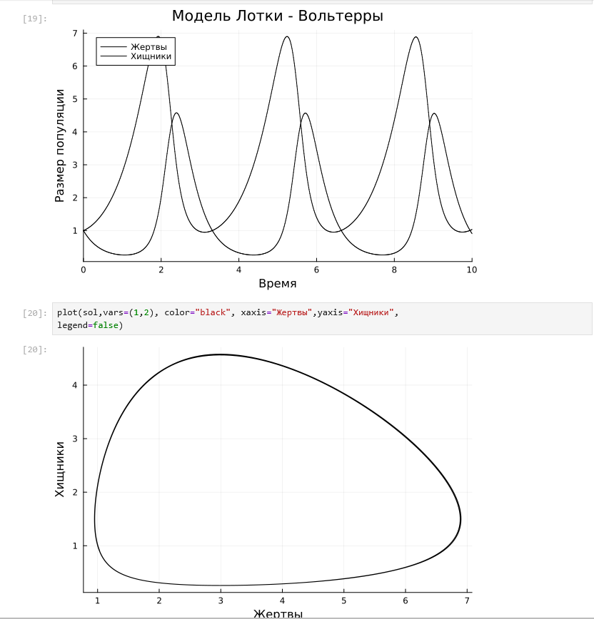{height=55%}

# Задание 6.4.1. Модель Мальтуса

* Экспоненциальный рост x(t) при a = b − c = 0.2.

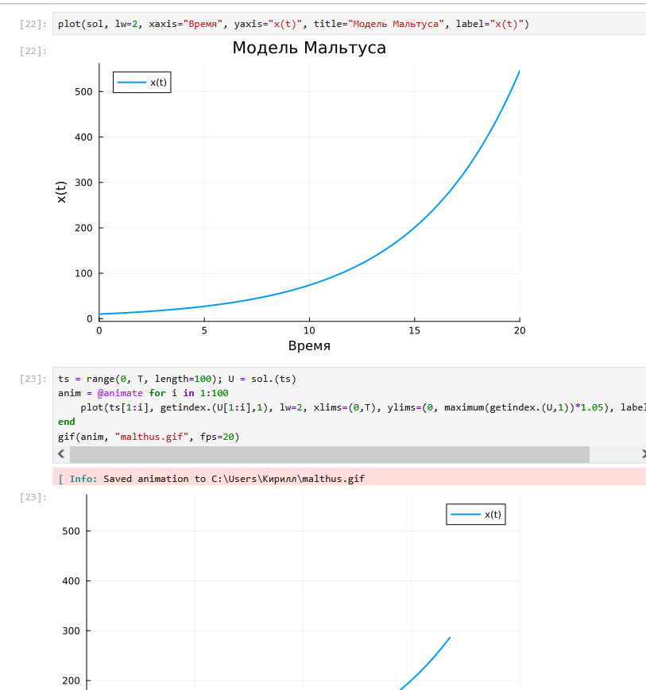{height=55%}

# Задание 6.4.2. Логистическая модель

* Рост к ёмкости среды k = 100.

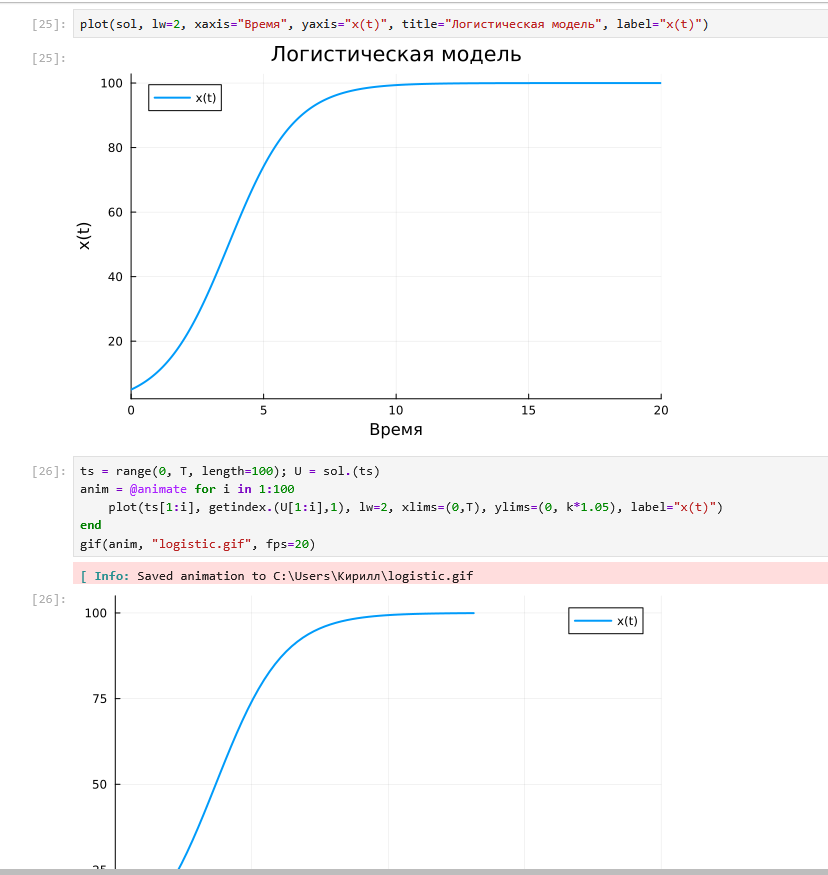{height=55%}

# Задание 6.4.3. Модель SIR

* Динамика долей s, i, r при β = 0.5, ν = 0.1.

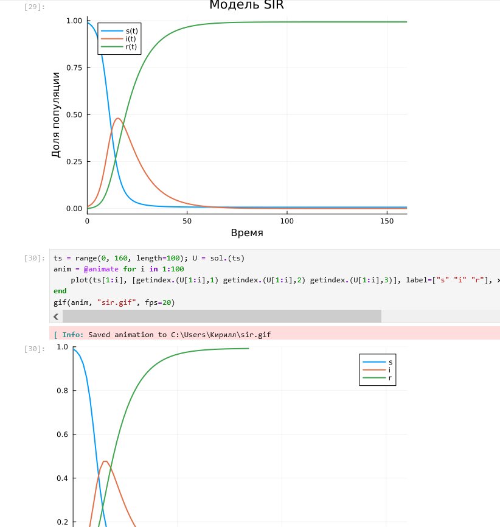{height=55%}

# Задание 6.4.4. Модель SEIR

* Сравнение числа инфицированных в SEIR и SIR.
* SEIR даёт более низкий и поздний пик.

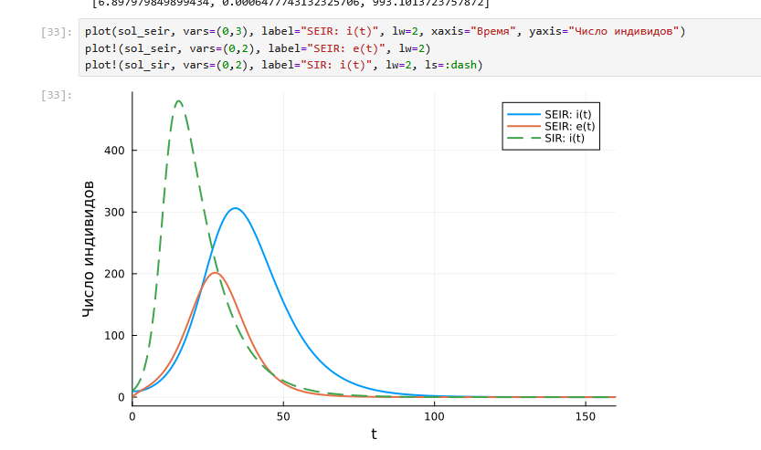{height=55%}

# Задание 6.4.5. Дискретная модель

* Численное решение сходится к равновесию (0.4, 0.2).

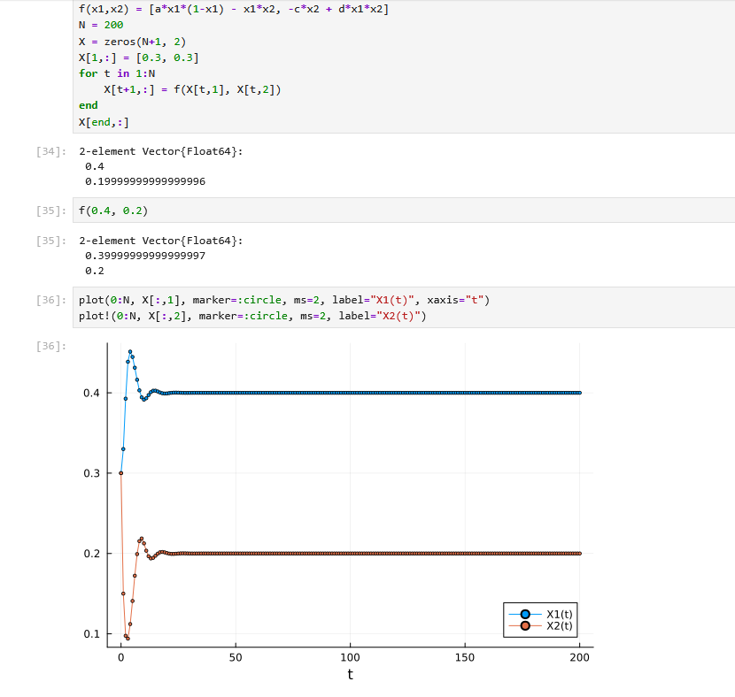{height=55%}

# Задание 6.4.5. Фазовый портрет

* Траектория из (0.3, 0.3) приходит в точку равновесия.

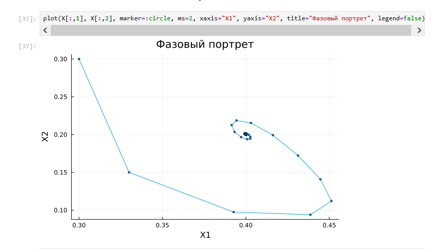{height=55%}

# Задание 6.4.6. Модель конкуренции

* Численности x и y при одинаковом росте и конкуренции.

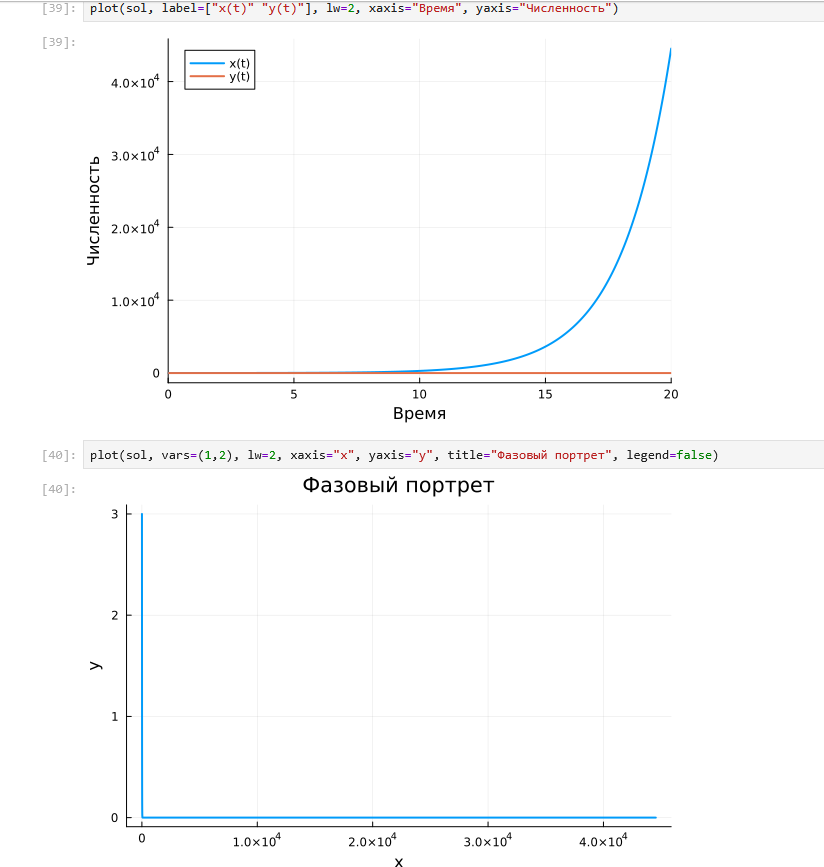{height=55%}

# Задание 6.4.7. Гармонический осциллятор

* Колебания x(t) и эллиптическая фазовая траектория.

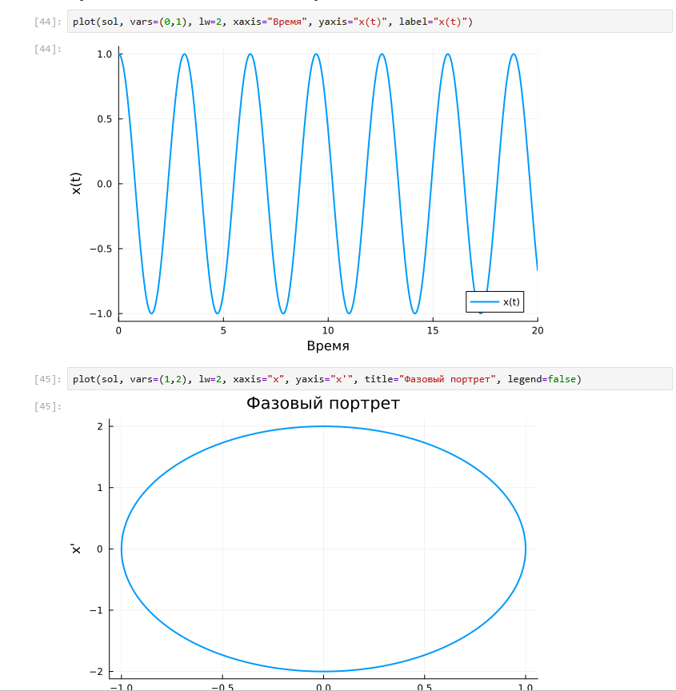{height=55%}

# Задание 6.4.7. Анимация осциллятора

* Анимация фазовой траектории.

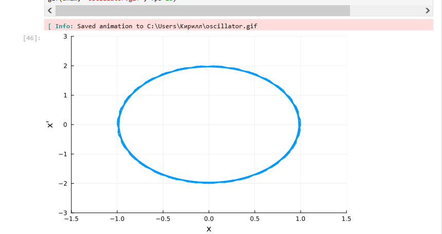{height=55%}

# Задание 6.4.8. Затухающий осциллятор

* Амплитуда убывает, фазовая траектория — спираль к началу координат.

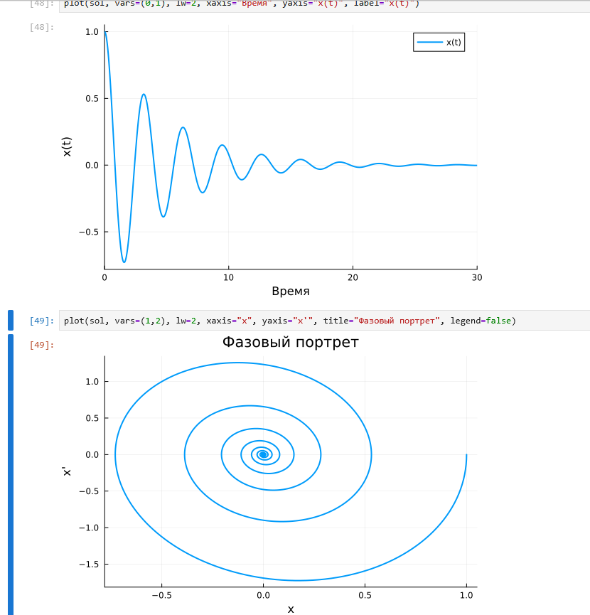{height=55%}

# Задание 6.4.8. Анимация затухающего осциллятора

* Анимация фазовой траектории.

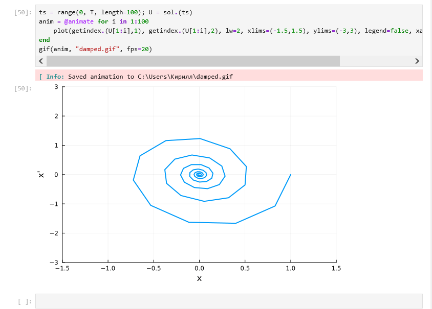{height=55%}

# Выводы

* Освоены DifferentialEquations.jl, ParameterizedFunctions.jl и Plots.jl.
* Решены модели роста, эпидемиологические модели, конкуренция и осцилляторы.
* Решена дискретная модель Лотки–Вольтерры, найдено равновесие.
