# Формулировка задания

**Цель работы.** Освоить специализированные пакеты Julia для решения задач в непрерывном и дискретном времени.

**Задание.**

1. Используя JupyterLab, повторить примеры из раздела 6.2 методички.
2. Выполнить задания для самостоятельной работы (раздел 6.4): модели Мальтуса, логистическая, SIR, SEIR, дискретная модель Лотки–Вольтерры, модель конкуренции, гармонический и затухающий осцилляторы.

# Выполнение работы

## Установка пакетов

```julia
import Pkg
Pkg.add(["DifferentialEquations", "Plots", "ParameterizedFunctions"])
using DifferentialEquations, Plots, ParameterizedFunctions
```

## Пример 6.2.1.1. Модель экспоненциального роста

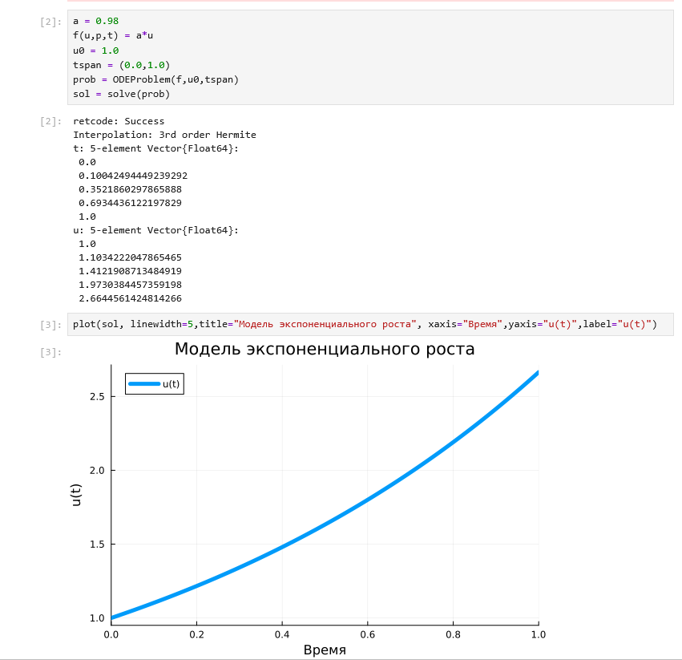{#fig-62}

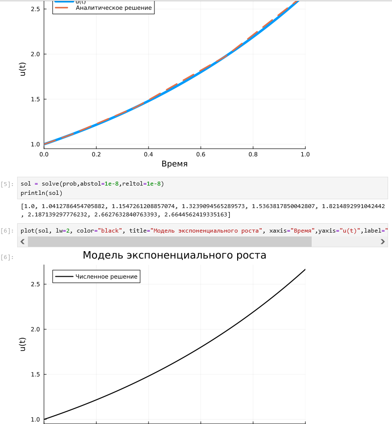{#fig-63}

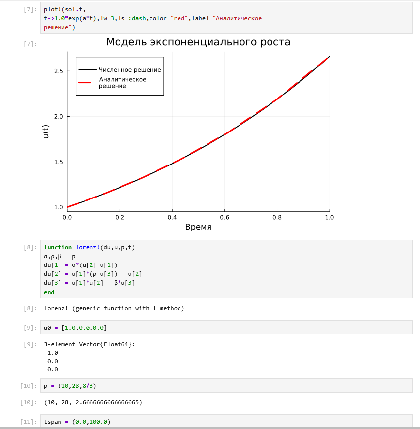{#fig-64}


```julia
a = 0.98
u0 = 1.0
tspan = (0.0, 1.0)
f(u,p,t) = a*u
prob = ODEProblem(f, u0, tspan)
sol = solve(prob)
```

```julia
plot(sol, linewidth=5, title="Модель экспоненциального роста", xaxis="Время", yaxis="u(t)", label="u(t)")
plot!(sol.t, t -> 1.0*exp(a*t), lw=3, ls=:dash, label="Аналитическое решение")
```

```julia
sol = solve(prob, abstol=1e-8, reltol=1e-8)
println(sol)
```

```julia
plot(sol, lw=2, color="black", title="Модель экспоненциального роста", xaxis="Время", yaxis="u(t)", label="Численное решение")
plot!(sol.t, t -> 1.0*exp(a*t), lw=3, ls=:dash, color="red", label="Аналитическое решение")
```

## Пример 6.2.1.2. Система Лоренца

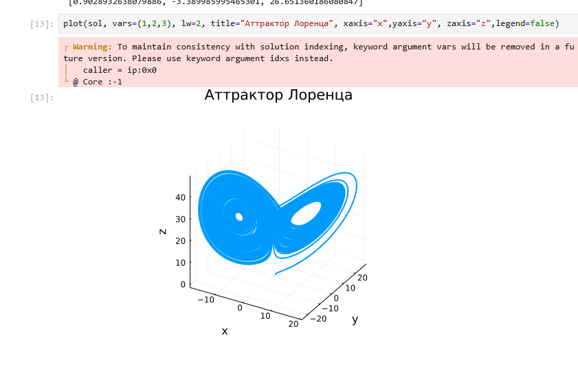{#fig-65}

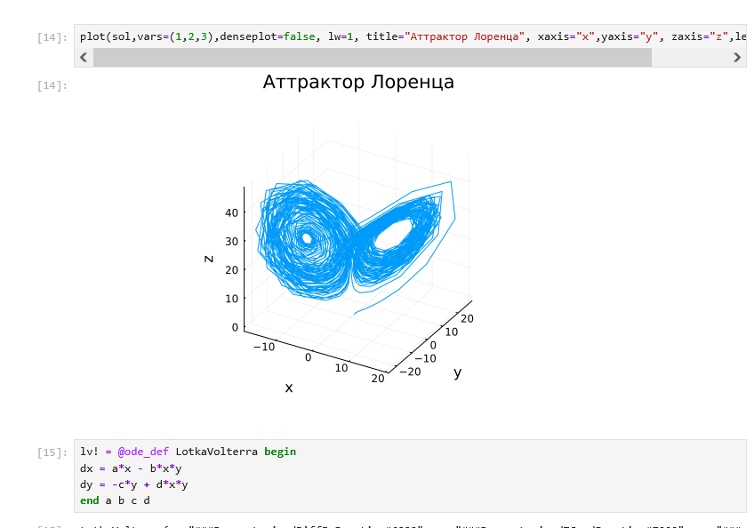{#fig-66}


```julia
function lorenz!(du,u,p,t)
    σ,ρ,β = p
    du[1] = σ*(u[2]-u[1])
    du[2] = u[1]*(ρ-u[3]) - u[2]
    du[3] = u[1]*u[2] - β*u[3]
end
u0 = [1.0,0.0,0.0]
tspan = (0.0,100.0)
p = (10,28,8/3)
prob = ODEProblem(lorenz!, u0, tspan, p)
sol = solve(prob)
```

```julia
plot(sol, vars=(1,2,3), lw=2, title="Аттрактор Лоренца", xaxis="x", yaxis="y", zaxis="z", legend=false)
```

```julia
plot(sol, vars=(1,2,3), denseplot=false, lw=1, title="Аттрактор Лоренца", xaxis="x", yaxis="y", zaxis="z", legend=false)
```

## Пример 6.2.2. Модель Лотки–Вольтерры

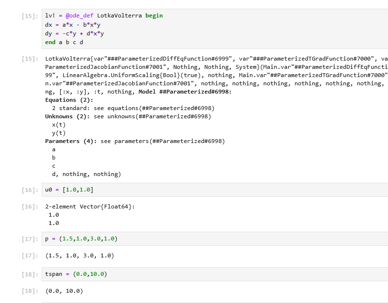{#fig-67}

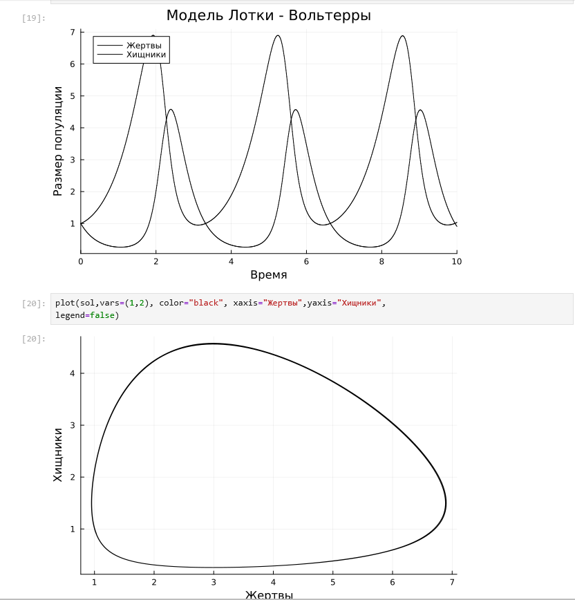{#fig-68}


```julia
lv! = @ode_def LotkaVolterra begin
    dx = a*x - b*x*y
    dy = -c*y + d*x*y
end a b c d
u0 = [1.0,1.0]
p = (1.5,1.0,3.0,1.0)
tspan = (0.0,10.0)
prob = ODEProblem(lv!, u0, tspan, p)
sol = solve(prob)
```

```julia
plot(sol, label=["Жертвы" "Хищники"], color="black", ls=[:solid :dash], title="Модель Лотки - Вольтерры", xaxis="Время", yaxis="Размер популяции")
```

```julia
plot(sol, vars=(1,2), color="black", xaxis="Жертвы", yaxis="Хищники", legend=false)
```

## Задание 6.4.1. Модель Мальтуса

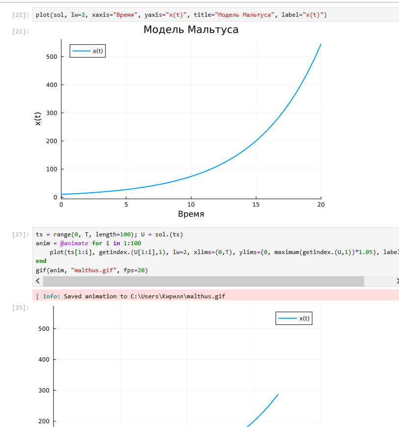{#fig-69}


```julia
b, c = 0.3, 0.1
a = b - c
x0 = 10.0
T = 20.0
prob = ODEProblem((x,p,t)->p*x, x0, (0.0,T), a)
sol = solve(prob, abstol=1e-8, reltol=1e-8)
```

```julia
plot(sol, lw=2, xaxis="Время", yaxis="x(t)", title="Модель Мальтуса", label="x(t)")
```

```julia
ts = range(0, T, length=100); U = sol.(ts)
anim = @animate for i in 1:100
    plot(ts[1:i], getindex.(U[1:i],1), lw=2, xlims=(0,T), ylims=(0, maximum(getindex.(U,1))*1.05), label="x(t)")
end
gif(anim, "malthus.gif", fps=20)
```

## Задание 6.4.2. Логистическая модель роста

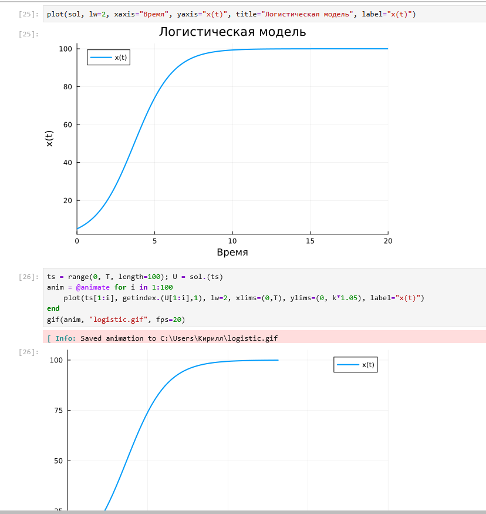{#fig-70}


```julia
r, k = 0.8, 100.0
x0 = 5.0
T = 20.0
prob = ODEProblem((x,p,t)->r*x*(1-x/k), x0, (0.0,T))
sol = solve(prob, abstol=1e-8, reltol=1e-8)
```

```julia
plot(sol, lw=2, xaxis="Время", yaxis="x(t)", title="Логистическая модель", label="x(t)")
```

```julia
ts = range(0, T, length=100); U = sol.(ts)
anim = @animate for i in 1:100
    plot(ts[1:i], getindex.(U[1:i],1), lw=2, xlims=(0,T), ylims=(0, k*1.05), label="x(t)")
end
gif(anim, "logistic.gif", fps=20)
```

## Задание 6.4.3. Модель SIR

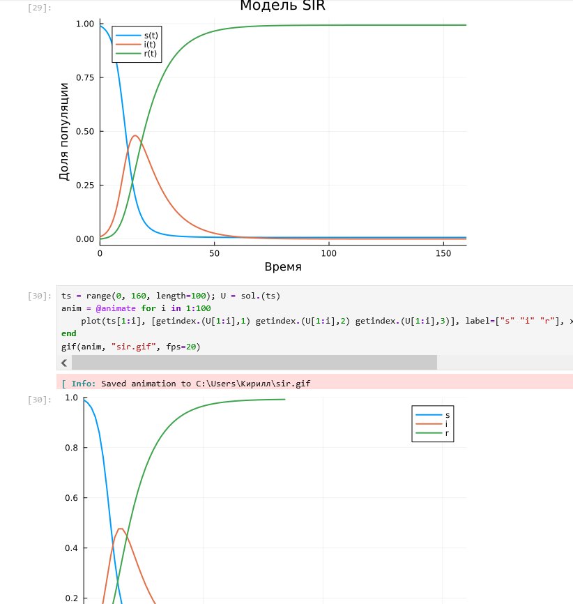{#fig-71}


```julia
function sir!(du,u,p,t)
    β,ν = p
    s,i,r = u
    du[1] = -β*i*s
    du[2] = β*i*s - ν*i
    du[3] = ν*i
end
β, ν = 0.5, 0.1
prob = ODEProblem(sir!, [0.99,0.01,0.0], (0.0,160.0), (β,ν))
sol = solve(prob)
```

```julia
plot(sol, label=["s(t)" "i(t)" "r(t)"], xaxis="Время", yaxis="Доля популяции", title="Модель SIR", lw=2)
```

```julia
ts = range(0, 160, length=100); U = sol.(ts)
anim = @animate for i in 1:100
    plot(ts[1:i], [getindex.(U[1:i],1) getindex.(U[1:i],2) getindex.(U[1:i],3)], label=["s" "i" "r"], xlims=(0,160), ylims=(0,1), lw=2)
end
gif(anim, "sir.gif", fps=20)
```

## Задание 6.4.4. Модель SEIR и сравнение с SIR

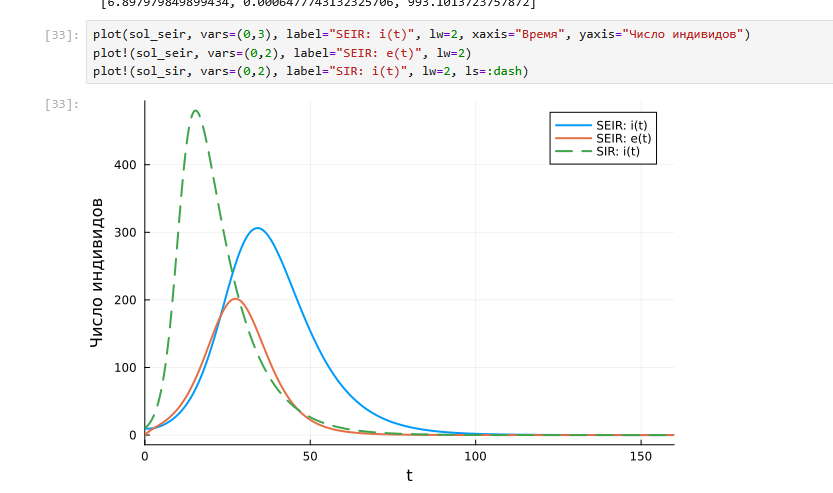{#fig-72}


```julia
N = 1000.0
function seir!(du,u,p,t)
    β,N,δ,γ = p
    s,e,i,r = u
    du[1] = -β/N*s*i
    du[2] = β/N*s*i - δ*e
    du[3] = δ*e - γ*i
    du[4] = γ*i
end
sol_seir = solve(ODEProblem(seir!, [990.0,0.0,10.0,0.0], (0.0,160.0), (0.5,N,0.2,0.1)))
```

```julia
function sir_abs!(du,u,p,t)
    β,N,γ = p
    s,i,r = u
    du[1] = -β/N*s*i
    du[2] = β/N*s*i - γ*i
    du[3] = γ*i
end
sol_sir = solve(ODEProblem(sir_abs!, [990.0,10.0,0.0], (0.0,160.0), (0.5,N,0.1)))
```

```julia
plot(sol_seir, vars=(0,3), label="SEIR: i(t)", lw=2, xaxis="Время", yaxis="Число индивидов")
plot!(sol_seir, vars=(0,2), label="SEIR: e(t)", lw=2)
plot!(sol_sir, vars=(0,2), label="SIR: i(t)", lw=2, ls=:dash)
```

## Задание 6.4.5. Дискретная модель Лотки–Вольтерры

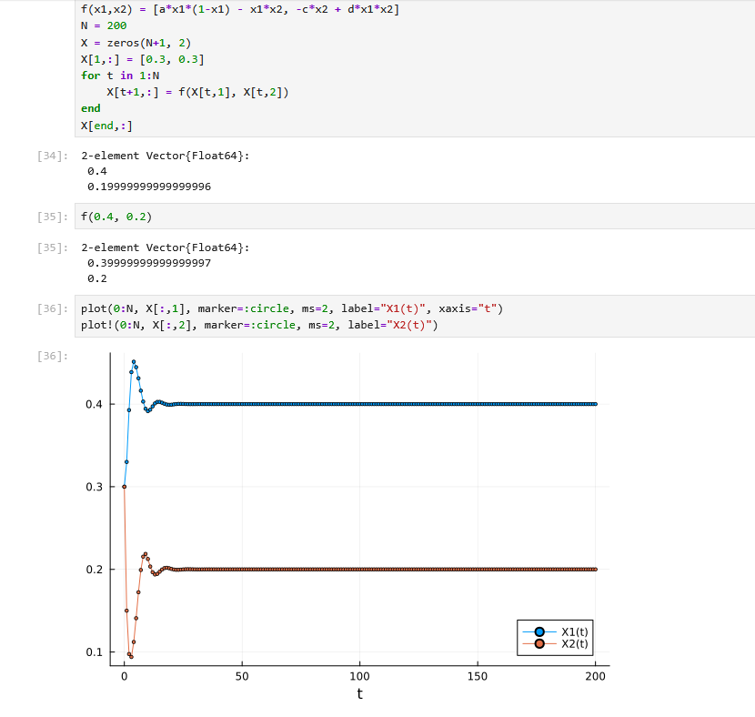{#fig-73}

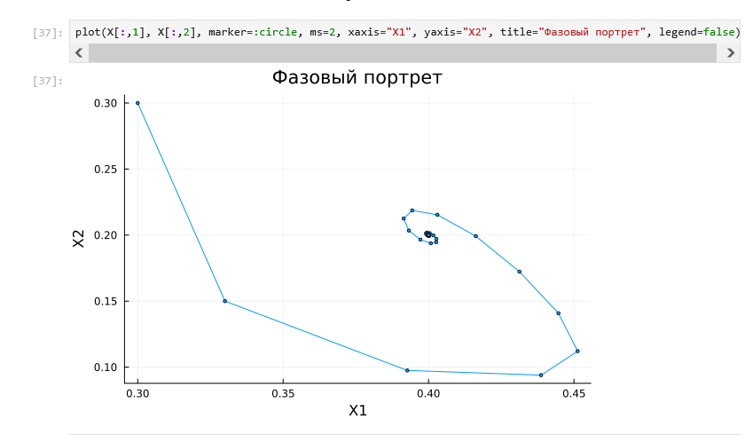{#fig-74}


```julia
a, c, d = 2.0, 1.0, 5.0
f(x1,x2) = [a*x1*(1-x1) - x1*x2, -c*x2 + d*x1*x2]
N = 200
X = zeros(N+1, 2)
X[1,:] = [0.3, 0.3]
for t in 1:N
    X[t+1,:] = f(X[t,1], X[t,2])
end
X[end,:]
```

```julia
f(0.4, 0.2)
```

```julia
plot(0:N, X[:,1], marker=:circle, ms=2, label="X1(t)", xaxis="t")
plot!(0:N, X[:,2], marker=:circle, ms=2, label="X2(t)")
```

```julia
plot(X[:,1], X[:,2], marker=:circle, ms=2, xaxis="X1", yaxis="X2", title="Фазовый портрет", legend=false)
```

## Задание 6.4.6. Модель отбора на основе конкурентных отношений

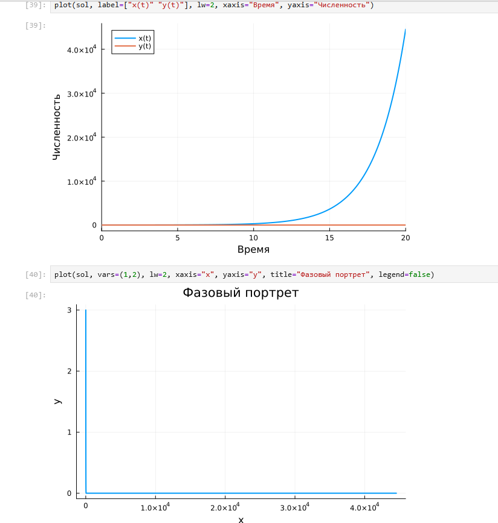{#fig-75}


```julia
function comp!(du,u,p,t)
    α,β = p
    x,y = u
    du[1] = α*x - β*x*y
    du[2] = α*y - β*x*y
end
α, β = 0.5, 0.1
u0 = [5.0, 3.0]
T = 20.0
prob = ODEProblem(comp!, u0, (0.0,T), (α,β))
sol = solve(prob)
```

```julia
plot(sol, label=["x(t)" "y(t)"], lw=2, xaxis="Время", yaxis="Численность")
```

```julia
plot(sol, vars=(1,2), lw=2, xaxis="x", yaxis="y", title="Фазовый портрет", legend=false)
```

```julia
ts = range(0, T, length=100); U = sol.(ts)
anim = @animate for i in 1:100
    plot(getindex.(U[1:i],1), getindex.(U[1:i],2), lw=2, xlims=(0,6), ylims=(0,6), legend=false, xaxis="x", yaxis="y")
end
gif(anim, "competition.gif", fps=20)
```

## Задание 6.4.7. Консервативный гармонический осциллятор

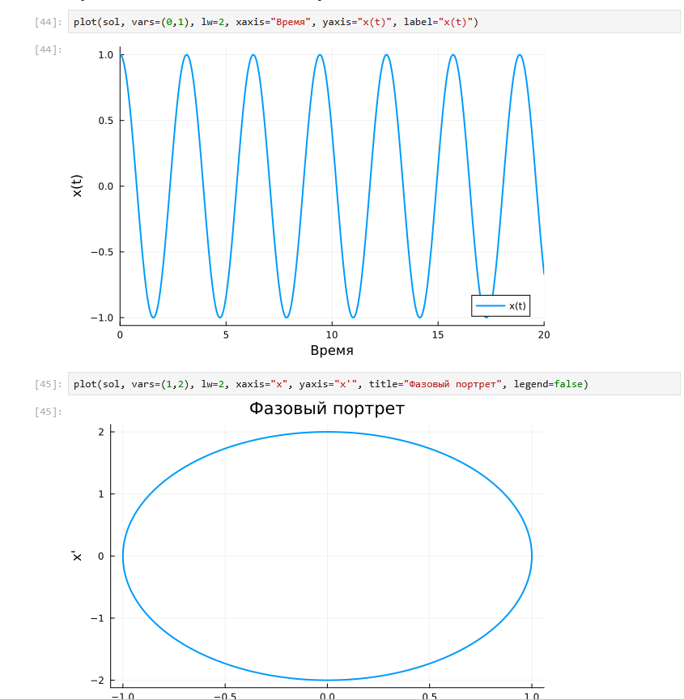{#fig-76}

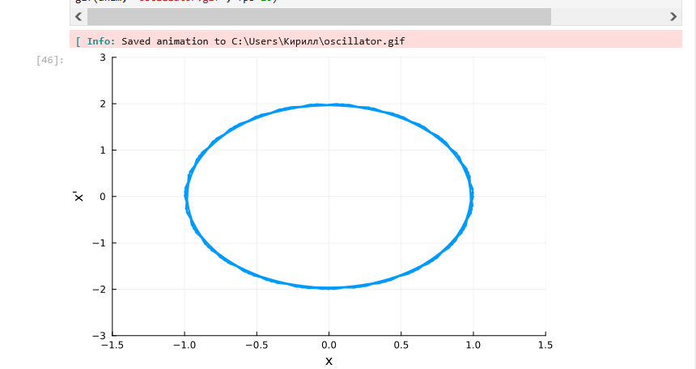{#fig-77}


```julia
function osc!(du,u,p,t)
    ω = p
    du[1] = u[2]
    du[2] = -ω^2*u[1]
end
ω0 = 2.0
x0, y0 = 1.0, 0.0
T = 20.0
prob = ODEProblem(osc!, [x0,y0], (0.0,T), ω0)
sol = solve(prob, abstol=1e-8, reltol=1e-8)
```

```julia
plot(sol, vars=(0,1), lw=2, xaxis="Время", yaxis="x(t)", label="x(t)")
```

```julia
plot(sol, vars=(1,2), lw=2, xaxis="x", yaxis="x'", title="Фазовый портрет", legend=false)
```

```julia
ts = range(0, T, length=100); U = sol.(ts)
anim = @animate for i in 1:100
    plot(getindex.(U[1:i],1), getindex.(U[1:i],2), lw=2, xlims=(-1.5,1.5), ylims=(-3,3), legend=false, xaxis="x", yaxis="x'")
end
gif(anim, "oscillator.gif", fps=20)
```

## Задание 6.4.8. Затухающий гармонический осциллятор

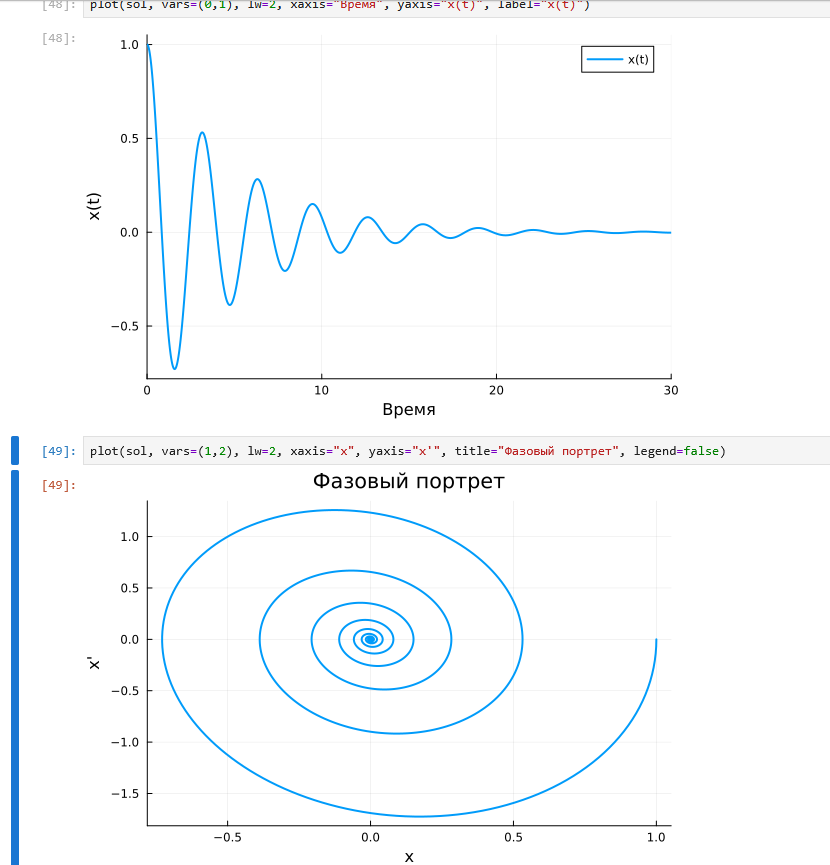{#fig-78}

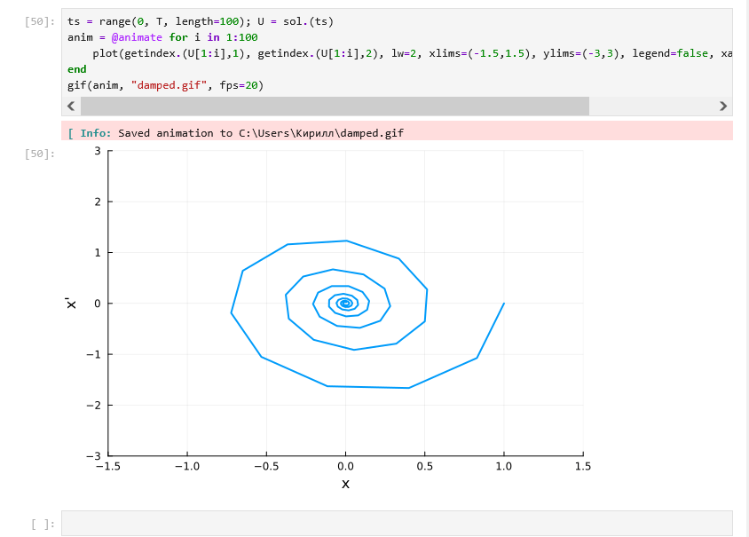{#fig-79}


```julia
function damped!(du,u,p,t)
    γ,ω = p
    du[1] = u[2]
    du[2] = -2γ*u[2] - ω^2*u[1]
end
γ, ω0 = 0.2, 2.0
x0, y0 = 1.0, 0.0
T = 30.0
prob = ODEProblem(damped!, [x0,y0], (0.0,T), (γ,ω0))
sol = solve(prob, abstol=1e-8, reltol=1e-8)
```

```julia
plot(sol, vars=(0,1), lw=2, xaxis="Время", yaxis="x(t)", label="x(t)")
```

```julia
plot(sol, vars=(1,2), lw=2, xaxis="x", yaxis="x'", title="Фазовый портрет", legend=false)
```

```julia
ts = range(0, T, length=100); U = sol.(ts)
anim = @animate for i in 1:100
    plot(getindex.(U[1:i],1), getindex.(U[1:i],2), lw=2, xlims=(-1.5,1.5), ylims=(-3,3), legend=false, xaxis="x", yaxis="x'")
end
gif(anim, "damped.gif", fps=20)
```

# Выводы

В ходе работы освоены пакеты `DifferentialEquations.jl`, `ParameterizedFunctions.jl` и `Plots.jl`. Решены обыкновенные дифференциальные уравнения: модели роста (экспоненциальный, Мальтуса, логистический), эпидемиологические модели SIR и SEIR, модель конкуренции, гармонический и затухающий осцилляторы. Решена дискретная модель Лотки–Вольтерры, найдено равновесие и построен фазовый портрет. Для большинства моделей построены графики решений и анимации.
